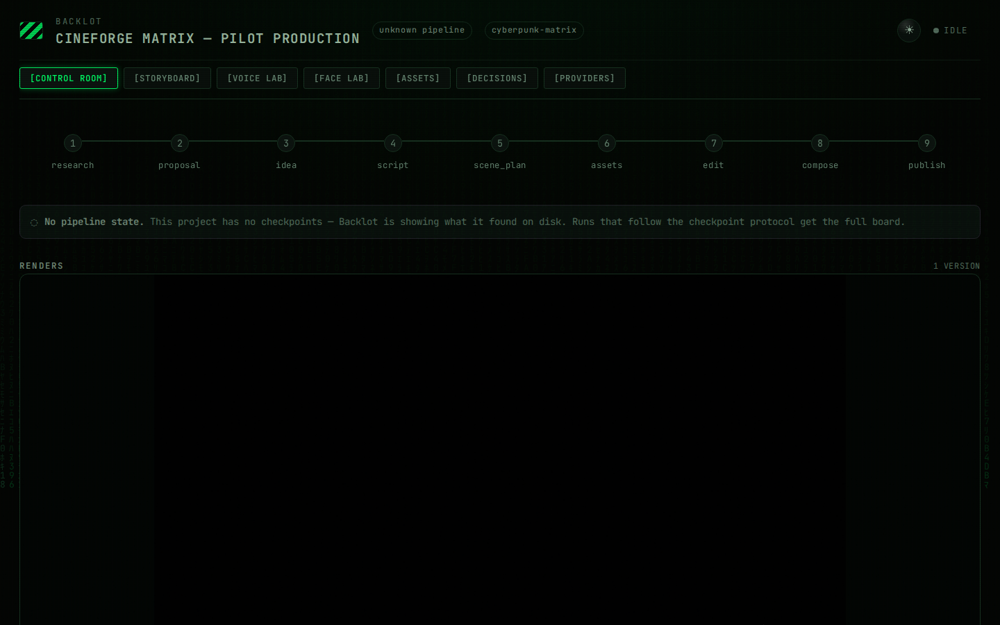
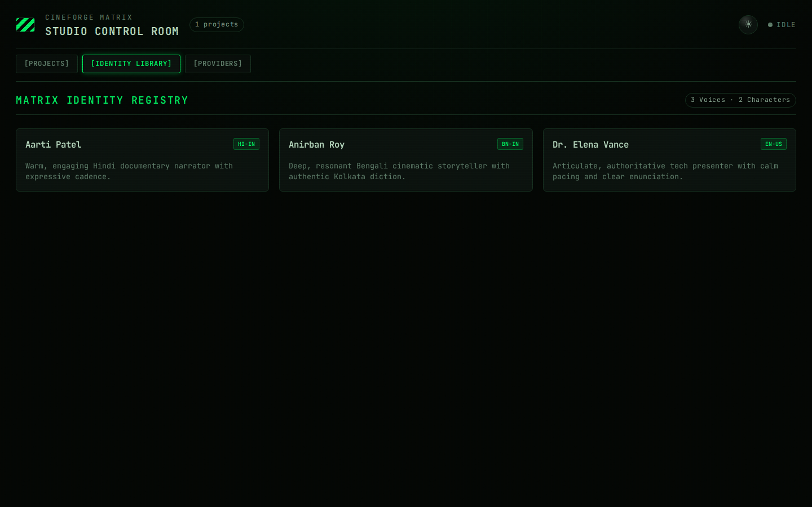
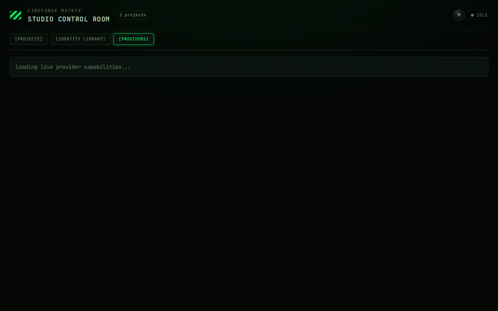

<p align="center">
  <picture>
    <source media="(prefers-color-scheme: dark)" srcset="assets/cineforge-dark.svg">
    
  </picture>
</p>

<p align="center"><sub><em>Monty the Clapper — the official mascot of CineForge</em></sub></p>

<h1 align="center">CineForge Matrix Studio</h1>

<p align="center"><strong>Autonomous AI Film & Video Production System</strong></p>
<p align="center"><em>Turn your AI assistant into an end-to-end film studio: research, scripting, character consistency, voice cloning, motion editing, and final composition.</em></p>

<p align="center">
  <a href="#quick-start--installation">Quick Start</a> &nbsp;·&nbsp;
  <a href="#matrix-studio-control-room">Matrix Control Room</a> &nbsp;·&nbsp;
  <a href="#core-capabilities--use-cases">Use Cases</a> &nbsp;·&nbsp;
  <a href="#production-pipelines">Pipelines</a> &nbsp;·&nbsp;
  <a href="#architecture--design-principles">Architecture</a> &nbsp;·&nbsp;
  <a href="docs/PROVIDERS.md">Providers</a> &nbsp;·&nbsp;
  <a href="docs/IDENTITY_LIBRARY.md">Identity Library</a> &nbsp;·&nbsp;
  <a href="docs/VOICE_IDENTITY.md">Voice Studio</a> &nbsp;·&nbsp;
  <a href="docs/FACE_IDENTITY.md">Face Studio</a> &nbsp;·&nbsp;
  <a href="AGENT_GUIDE.md">Agent Guide</a>
</p>

<p align="center">
  <a href="LICENSE"></a>
  
  
  
  
</p>

<p align="center"><strong>Connect & Community</strong></p>

<p align="center">
  <a href="https://www.youtube.com/@CineForgeLab"></a>
  <a href="https://x.com/mr_sandipmandal"></a>
  <a href="https://github.com/mrsandipmandal/CineForge/discussions"></a>
</p>

---

## Production Studio Showcase

CineForge is an agent-first production system where plain language instructions drive verified, multi-stage pipelines. Below is a rendered title and motion sequence generated through the CineForge Matrix pipeline:

<div align="center">
  <video src="assets/cineforge-demo.mp4" poster="assets/cineforge-demo-poster.png" width="100%" controls autoplay loop muted></video>
  <p><sub><em>Rendered with CineForge Remotion engine (1080p, 30fps) — typography, layout, timing, and audio muxing generated via pipeline.</em></sub></p>
</div>

---

## Matrix Studio Control Room

**Backlot Matrix Edition** provides real-time telemetry, visual approval gates, asset contact sheets, and persistent identity registries in a cyberpunk green-on-black terminal UI (`#030804` background, `#00ff66` phosphor green accents, CRT scanlines, and animated digital rain).

### 1. Live Project Board (`/p/{project_id}`)
Monitors pipeline stages in real time via Server-Sent Events (SSE). Tracks generation cost, screenplay scenes, video takes, and pauses at approval gates before spending budget:

<p align="center">
  
</p>

### 2. Identity Library & Labs (`sample-files/`)
Inspect voice recordings, language metadata (Bengali, Hindi, English), and multi-angle character portrait bundles across all scenes:

<p align="center">
  
</p>

### 3. System Provider Capability Envelope
Inspect registered image, video, voice, and composition engines, latency benchmarks, and active local GPU models:

<p align="center">
  
</p>

---

## Core Capabilities & Use Cases

CineForge differs fundamentally from ordinary "single-prompt prompt-to-video" tools. It mirrors a professional production studio:

### 1. Reference-Driven Video Production
Paste any YouTube video, Short, TikTok, or Instagram Reel:
```text
"Here is a YouTube Short I love. Analyze its structure, pacing, and hooks, and make an original 60-second version about quantum computing."
```
The agent executes `video_analyzer`, extracts the transcript, breaks down scene pacing, and proposes **2-3 differentiated creative treatments** with clear cost projections.

### 2. Multi-Angle Character & Face Consistency
Create reusable characters in `sample-files/characters/` with multi-view portraits (`front`, `left_quarter`, `right_quarter`, `expression`). The system injects conditioning bundles into video models (Kling, Seedance, Wan2.1) so the same character appears consistently across different scenes, camera angles, and projects.

### 3. Multilingual Voice Studio (Bengali, Hindi, English)
Native multi-language voice identity management:
- **Bengali (`bn-IN`)**: Preserves native phonetics and script without English transliteration artifacts.
- **Hindi (`hi-IN`)**: Natural prosody and cadence.
- **English (`en-US`)**: Expressive, conversational, and narration modes.
- Supports reference-audio voice cloning (ElevenLabs, Fish Audio, IndicF5, Coqui XTTS) with mandatory actor consent verification (`consent_verified: true`).

### 4. Zero-Cost Real-Footage Documentaries
CineForge can build real documentaries without paying for generative video models:
- Searches and downloads high-resolution open archival footage from **Archive.org**, **NASA**, and **Wikimedia Commons**.
- Indexes footage with CLIP semantic embeddings and cuts a synchronized motion timeline with **Piper TTS** (offline local voice) and **FFmpeg**.

### 5. Automated Social Clip Factory
Feed in an hour-long podcast, interview, or lecture. The agent transcribes with WhisperX, scores moments for hook strength, trims optimal 30-60 second clips, adds TikTok-style word-level subtitles, and re-frames to 9:16 vertical video.

---

## Quick Start & Installation

### Prerequisites

- **Python 3.10, 3.11, or 3.12** — [python.org](https://www.python.org/downloads/)
- **Node.js 20+** — [nodejs.org](https://nodejs.org/)
- **FFmpeg 6.0+** — `sudo apt install ffmpeg` / `brew install ffmpeg` / [ffmpeg.org](https://ffmpeg.org/download.html)
- **Git** — [git-scm.com](https://git-scm.com/)

### Step 1: Clone & Setup

```bash
# 1. Clone repository
git clone https://github.com/mrsandipmandal/CineForge.git
cd CineForge

# 2. Automated setup (creates .venv, installs Python & Remotion packages)
make setup
```

*Manual Setup alternative (macOS/Linux):*
```bash
python3 -m venv .venv
source .venv/bin/activate
pip install -e ".[dev]"
cd remotion-composer && npm install && cd ..
pip install piper-tts
cp .env.example .env
```

*Manual Setup alternative (Windows PowerShell):*
```powershell
py -3 -m venv .venv
.\.venv\Scripts\Activate.ps1
pip install -e ".[dev]"
cd remotion-composer; npm install; cd ..
pip install piper-tts
Copy-Item .env.example .env
```

### Step 2: Configure Environment

Every API key is optional. The system operates fully offline with Piper TTS, open archival stock, and Remotion/HyperFrames:

```bash
# Edit .env to add keys for cloud models you wish to enable:
cp .env.example .env

# Popular options:
# ELEVENLABS_API_KEY=your_key     # Premium voice cloning & sound effects
# FAL_KEY=your_key                # FLUX images, Kling video, Veo video
# PEXELS_API_KEY=your_key         # Free stock footage
# PIXABAY_API_KEY=your_key        # Free stock audio & video
```

### Step 3: Launch Backlot Matrix Studio

```bash
# Start Backlot Live Control Room (accessible at http://127.0.0.1:8765)
python -m backlot.server

# Or open browser directly:
python -m backlot open
```

---

## Production Pipelines

Every video production request maps to an auditable pipeline manifest in `pipeline_defs/`:

```
research  →  proposal  →  script  →  scene_plan  →  assets  →  edit  →  compose  →  publish
```

| Pipeline | Target Format | Primary Use Case |
| :--- | :--- | :--- |
| **`animated_explainer`** | 16:9 / 9:16 | Educational explainers, tech breakdowns, diagrams, voiceover |
| **`character_animation`** | 16:9 / 9:16 | 2D/3D character rigs, pose libraries, GSAP timelines, SVG acting |
| **`cinematic`** | 16:9 / 21:9 | Cinematic trailers, high-concept teasers, sci-fi/fantasy mood pieces |
| **`documentary_montage`** | 16:9 | Archival documentaries, historical essays (Archive.org, NASA, Wikimedia) |
| **`youtube_shorts`** | 9:16 | Fast-paced short-form content, kinetic subtitles, hook optimization |
| **`talking_head`** | 9:16 / 16:9 | Presenter videos, SadTalker/Wav2Lip avatar sync, interviews |
| **`clip_factory`** | 9:16 | Batch repurposing long-form footage into ranked social clips |
| **`screen_demo`** | 16:9 | Polished software walkthroughs, cursor smoothing, terminal demos |

---

## Architecture & Design Principles

```
CineForge Matrix/
├── tools/                 # 100+ production tools (BaseTool subclasses)
│   ├── audio/             # Voice identity, TTS selector, audio mixer, Suno
│   ├── avatar/            # Character face identity, talking head, lip-sync
│   ├── video/             # Video generation, clip search, stitcher, trimmer
│   ├── graphics/          # FLUX, Imagen, Grok, diagrams, code snippets
│   ├── analysis/          # WhisperX transcriber, scene detector, frame sampler
│   └── enhancement/       # Face restoration (CodeFormer), upscale, background removal
│
├── sample-files/          # Identity Library: voices/, faces/, characters/, manifests/
├── pipeline_defs/         # Pipeline manifests (stages, tools, human approval gates)
├── skills/                # Stage director skills & quality review checklists
├── backlot/               # Backlot Matrix Studio (FastAPI, SSE change feed, Matrix UI)
├── remotion-composer/     # React / Remotion composition engine (1080p/4K video)
├── lib/                   # Checkpoints, pipeline loader, cost tracker, state machine
└── tests/                 # 100+ contract tests, integration tests, security tests
```

### Core Architecture Rules:
1. **The AI Agent is the Director**: Orchestration logic lives in transparent, readable markdown instructions (`skills/pipelines/`). Python provides robust tools and state persistence.
2. **Deterministic Checkpointing**: Every stage saves to `projects/<name>/checkpoints/latest.json`. Productions can be resumed, replayed, or branched at any point.
3. **Auditable Decision Log**: Every provider selection, cost estimate, and visual style decision is logged with alternatives considered and confidence scores.
4. **Pre-Compose & Post-Render Quality Gates**: Automated validation stops broken plans before spending compute. Post-render self-review runs `ffprobe`, audio clipping checks, and frame analysis before presenting output.

---

## Testing & Quality Assurance

CineForge includes an extensive automated test suite covering BaseTool contracts, identity library scanning, Backlot endpoints, and security boundaries:

```bash
# Run contract and library tests (zero API keys needed)
make test-contracts

# Run full test suite with coverage
pytest tests/ -v

# Run Backlot backend smoke tests
pytest tests/backlot/ -v
```

---

## Documentation Index

- [Identity Library Architecture](docs/IDENTITY_LIBRARY.md) — Persistent voice and character profile layout.
- [Voice Identity Studio & Capability Matrix](docs/VOICE_IDENTITY.md) — Multilingual setup, cloning, and consent protocol.
- [Face & Character Identity Studio](docs/FACE_IDENTITY.md) — Multi-view character reference guidelines.
- [Matrix Studio UI & Terminal System](docs/MATRIX_UI.md) — Backlot green-on-black interface design system.
- [AI Provider Matrix & Pricing](docs/PROVIDERS.md) — Detailed guide covering 60+ video, image, and voice providers.
- [Upgrade & Migration Guide](docs/UPGRADE_MIGRATION.md) — Transitioning from legacy setups.
- [Agent Operating Contract](AGENT_GUIDE.md) — Mandatory agent protocols and execution rules.

---

## Community & Support

- **YouTube**: [@CineForgeLab](https://www.youtube.com/@CineForgeLab) — Video tutorials, production breakdowns, and showcase reels.
- **X (Twitter)**: [@mr_sandipmandal](https://x.com/mr_sandipmandal) — Developer updates, release announcements, and build notes.
- **GitHub Discussions**: [CineForge Discussions](https://github.com/mrsandipmandal/CineForge/discussions) — Ask questions, suggest new pipelines, and share generated films.
- **Issues**: [GitHub Issue Tracker](https://github.com/mrsandipmandal/CineForge/issues) — Report bugs or request tools.

---

## License

This project is licensed under the **GNU Affero General Public License v3.0 (AGPL-3.0)**. See the [LICENSE](LICENSE) file for details.
