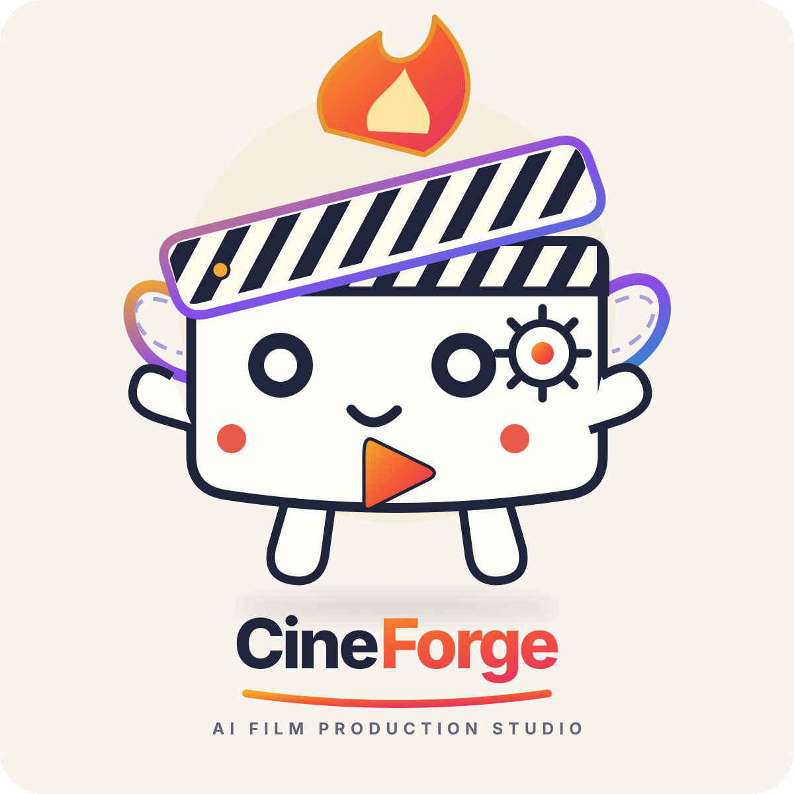
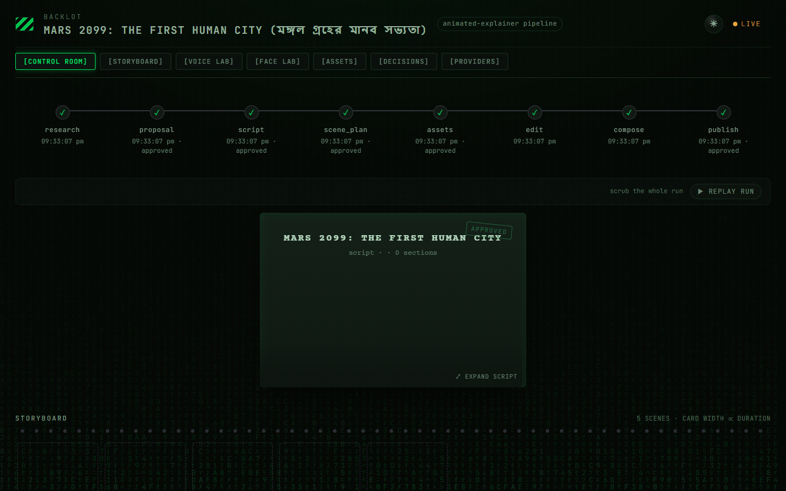
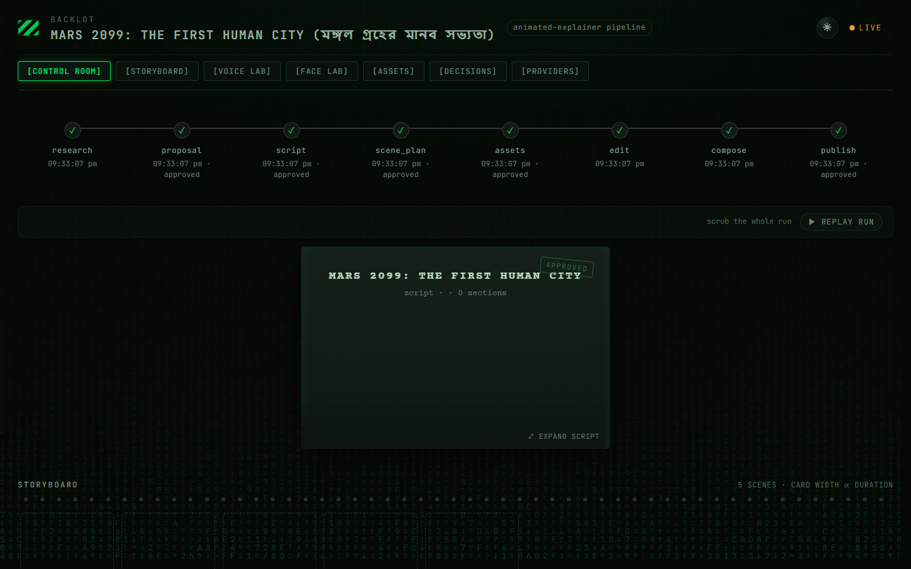
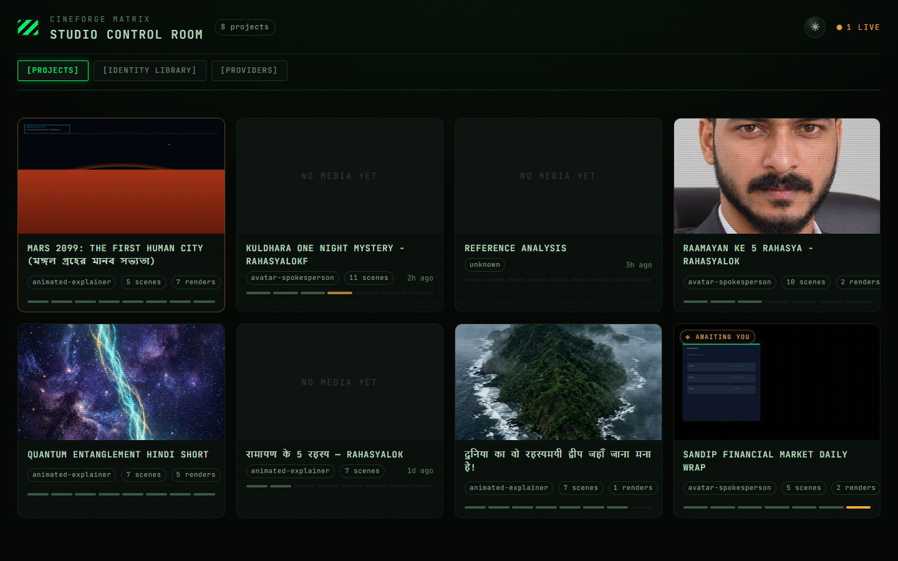

<p align="center">
  <picture>
    <source media="(prefers-color-scheme: dark)" srcset="assets/cineforge-dark.svg">
    
  </picture>
</p>

<p align="center"><sub><em>Monty the Clapper — the official mascot of CineForge</em></sub></p>

<h1 align="center">CineForge Matrix Studio</h1>

<p align="center"><strong>Autonomous AI Film & Video Production System</strong></p>
<p align="center"><em>Turn your AI assistant into an end-to-end film studio: research, scripting, character consistency, voice cloning, motion editing, and final composition.</em></p>

<p align="center">
  <a href="#-quick-start--installation">⚡ Quick Start</a> &nbsp;·&nbsp;
  <a href="#-shortcuts--quick-commands-reference">⌨️ Shortcuts Cheat Sheet</a> &nbsp;·&nbsp;
  <a href="#-complete-documentation-index">📚 Documentation Index</a> &nbsp;·&nbsp;
  <a href="#-science-explainer-shorts--multi-language-autonomous-production">🔬 Science Explainer</a> &nbsp;·&nbsp;
  <a href="#-matrix-studio-control-room">🎛️ Control Room</a> &nbsp;·&nbsp;
  <a href="#-production-pipelines">🎬 Pipelines</a> &nbsp;·&nbsp;
  <a href="AGENT_GUIDE.md">🤖 Agent Guide</a>
</p>

<p align="center">
  <a href="LICENSE"></a>
  
  
  
  
  <a href="https://github.com/mrsandipmandal/CineForge/releases"></a>
</p>

<p align="center"><strong>Connect & Community</strong></p>

<p align="center">
  <a href="https://www.youtube.com/@CineForgeLab"></a>
  <a href="https://x.com/mr_sandipmandal"></a>
  <a href="https://github.com/mrsandipmandal/CineForge/discussions"></a>
</p>

---

## ⚡ Quick Start & Installation

Get your studio up and running in **under 60 seconds**. No paid API keys are required to produce complete videos — CineForge ships with free offline neural TTS (Piper/Edge), open-source stock indexing, and local FFmpeg/Remotion compositing engines out of the box.

### Prerequisites

| Tool | Version | Purpose | Installation |
| :--- | :---: | :--- | :--- |
| **Python** | `3.10 – 3.12` | Studio engine, tool registry & pipelines | [python.org](https://www.python.org/downloads/) |
| **FFmpeg** | `6.0+` | Video encoding, Ken-Burns, audio synthesis | `sudo apt install ffmpeg` / `brew install ffmpeg` / [ffmpeg.org](https://ffmpeg.org/download.html) |
| **Node.js** | `20+` | Remotion React & HyperFrames motion engines | [nodejs.org](https://nodejs.org/) |
| **Git** | Any | Repository management & version control | [git-scm.com](https://git-scm.com/) |

---

### Step 1: One-Command Automated Setup

```bash
# Clone the repository
git clone https://github.com/mrsandipmandal/CineForge.git
cd CineForge

# One-command automated environment setup (venv, python packages & remotion engine)
make setup
```

<details>
<summary><strong>Manual Setup Alternative (macOS / Linux / WSL)</strong></summary>

```bash
# 1. Create and activate virtual environment
python3 -m venv .venv
source .venv/bin/activate

# 2. Install Python packages & dev tools
pip install --upgrade pip
pip install -e ".[dev]"
pip install piper-tts

# 3. Install Remotion composer engine
cd remotion-composer && npm install && cd ..

# 4. Copy environment configuration
cp .env.example .env
```
</details>

<details>
<summary><strong>Manual Setup Alternative (Windows PowerShell)</strong></summary>

```powershell
# 1. Create and activate virtual environment
py -3 -m venv .venv
.\.venv\Scripts\Activate.ps1

# 2. Install Python dependencies
pip install --upgrade pip
pip install -e ".[dev]"
pip install piper-tts

# 3. Install Remotion composer engine
cd remotion-composer; npm install; cd ..

# 4. Copy environment configuration
Copy-Item .env.example .env
```
</details>

---

### Step 2: Configure Keys (Optional — $0.00 Mode Works Immediately)

Every paid API key is optional. The studio functions offline with free neural TTS and open media:

```bash
# Edit .env to add keys for commercial models you wish to unlock:
nano .env # or code .env / notepad .env

# Recommended additions:
# ELEVENLABS_API_KEY=your_key   # Studio voice cloning & SFX
# FAL_KEY=your_key              # FLUX.1/FLUX.2 image models & Kling/Veo video
# PEXELS_API_KEY=your_key       # Free HD stock footage library
```

---

### Step 3: Launch Backlot Control Room

```bash
# Start Backlot Matrix Studio server and launch browser at http://127.0.0.1:4750
python -m backlot open
```

---

## ⌨️ Shortcuts & Quick Commands Reference

Keep this cheat sheet handy to control your studio from the command line or any AI coding IDE:

### 🛠️ Terminal & CLI Shortcuts

| Shortcut / Command | Action |
| :--- | :--- |
| `make setup` | Complete 1-click install (venv, Python packages, Remotion dependencies) |
| `python -m backlot open` | Launch the Backlot Matrix live control room in your default browser |
| `python -m backlot open <project-id>` | Open live monitoring for a specific production workspace |
| `make demo` | Render all three zero-key showcase demos instantly |
| `./render-demo.sh world-in-numbers` | Render the 45s data-visualization explainer demo |
| `make test-contracts` | Run contract tests across all 175 production tools (zero API spend) |
| `pytest tests/ -v` | Execute full test suite (1,308 verified tests) |
| `python -m backlot.server` | Start the Backlot backend daemon on port `4750` (or `8765`) |

---

### 💬 AI Agent Prompt Shortcuts (Universal IDE Access)

Copy and paste these directly into **Google Antigravity**, **Claude Code**, **Cursor**, **Windsurf**, or **GitHub Copilot**:

| Prompt Shortcut | Target Deliverable | Workflow Triggered |
| :--- | :--- | :--- |
| `"make a science video"` | 9:16 / 16:9 Mystery Short | Dynamic language Q&A → Live web research → Top-6 topics → 1-gate approval |
| `"বিজ্ঞান ভিডিও বানাও"` | 9:16 Bengali Science Short | Native Bengali voiceover (`bn-IN`), deep-sea/physics CGI, Nirmala UI subtitles |
| `"/science-explainer"` | Multi-Language Explainer | Launches interactive Science Explainer Shorts skill (`bengali-science-explainer`) |
| `"Here is a YouTube Short: <URL>. Make something like this about <Topic>"` | Reference-Led Short | Runs `video_analyzer` transcript & pacing extraction → Proposes 3 distinct treatments |
| `"Make a 60-second animated explainer about <Topic>"` | 1080p Animated Explainer | `animated_explainer` pipeline with Remotion kinetic cards and diagrams |
| `"Repurpose this podcast file <audio.mp3> into 5 viral shorts"` | Social Clip Pack | `clip_factory` pipeline with WhisperX transcription and TikTok-style word highlights |
| `"Make a historical documentary about <Event> with zero API cost"` | Archival Documentary | `documentary_montage` searching NASA, Archive.org, and Wikimedia Commons |

---

## 📚 Complete Documentation Index

| Guide | Description | Key Topics |
| :--- | :--- | :--- |
| [**Science Explainer Shorts Guide**](docs/SCIENCE_EXPLAINER.md) | Multi-language mystery & science video generator | 8+ neural languages, platform safe zones, ASS styling |
| [**Agent Operating Contract**](AGENT_GUIDE.md) | Mandatory agent protocols and execution rules | Preflight checks, decision logging, human approval gates |
| [**Shared Project Context**](PROJECT_CONTEXT.md) | Single source of truth for repository conventions | 3-layer knowledge system, tool catalog, pipeline state |
| [**Tested Prompt Gallery**](PROMPT_GALLERY.md) | Proven prompts producing broadcast-ready videos | Science shorts, data explainers, zero-key demos |
| [**AI Providers Matrix & Pricing**](docs/PROVIDERS.md) | Detailed comparison of 60+ generative models | Video, image, voice models, cost per minute & quotas |
| [**Voice Identity Studio**](docs/VOICE_IDENTITY.md) | Multilingual voice setup & reference cloning | Sarvam AI, Edge TTS, Piper, voice consent verification |
| [**Face & Character Identity**](docs/FACE_IDENTITY.md) | Persistent character consistency across cuts | Multi-angle character packs, LoRA bundles, seed locks |
| [**Matrix Studio UI System**](docs/MATRIX_UI.md) | Terminal control room design architecture | Cyberpunk CRT theme, SSE event stream, telemetry |
| [**Identity Library Architecture**](docs/IDENTITY_LIBRARY.md) | Persistent voice and actor profiles | Central asset repository layout and JSON schemas |
| [**Upgrade & Migration Guide**](docs/UPGRADE_MIGRATION.md) | Upgrading from legacy CineForge/OpenMontage | Breaking changes, manifest migrations, runtime adapters |

---

<a id="science-explainer-shorts--multi-language-autonomous-production"></a>
## 🔬 Science Explainer Shorts — Multi-Language Autonomous Production

CineForge includes an interactive, end-to-end production workflow for **Science Mystery Shorts, Nature Curiosities, and Educational Viral Videos**. It combines dynamic real-time web research, high-impact scriptwriting, AI imagery, 3D Ken-Burns camera movement, acoustic ambient synthesis, and burned kinetic typography — with **zero required API keys ($0.00 compute cost)**.

```
"make a science video" ──▶ Dynamic Language ──▶ Live Web Research ──▶ AI-Scored Top 6 Topics
                                                                             │
                                                                             ▼
Final Broadcast MP4 ◀── Full Pipeline ◀── Single Human Approval ◀── Interactive Feature Menu
 (Shorts/Reels 1080p)    (Images/TTS/Mix)    ("Approved!")          (Format, Style, Tone)
```

### Key Workflow Highlights

1. **Dynamic Language Selection**: The studio asks for your preferred language first, then switches **all subsequent user interaction, narration, script, and subtitles** into that language immediately. Supported out of the box: English, Bengali (বাংলা), Hindi (हिन्दी), Spanish (Español), French (Français), German (Deutsch), Arabic (العربية), Japanese (日本語), and more.
2. **AI-Led Trend & Fact Research**: Silently browses current scientific publications and viral anomalies, scoring candidates by *surprise factor*, *visual potential*, and *viewer retention* before proposing the top 6 concepts.
3. **Interactive Feature Menu (1 Message)**: Configure video format (9:16 vertical Short, 16:9 landscape, 1:1 square), aesthetic art direction (Photorealistic CGI, Nature Doc, Flat Vector, Dark Noir), narrator tone, video duration (45s, 60s, 90s), and soundscape in a single response (or reply `"all default"`).
4. **Transparent Production Plan & 1-Gate Approval**: Inspect the 5-scene breakdown, script preview, asset map, exact runtime, and cost breakdown before compute begins. Once approved, the agent runs research, scripting, image generation, audio synthesis, subtitles, and final FFmpeg assembly autonomously without interruptions.

### Supported Video Platforms & Technical Pacing

| Platform | Format | Resolution | Optimal Length | Pacing & Algorithmic Optimization |
| :--- | :---: | :---: | :---: | :--- |
| **YouTube Shorts** | `9:16` | 1080×1920 | 50–60s | 3s visual cliffhanger, centered subtitles with 170px bottom safety margin |
| **Instagram Reels** | `9:16` | 1080×1920 | 60–75s | Aesthetic 3D CGI visuals, crisp contrast typography, explore feed reach |
| **TikTok** | `9:16` | 1080×1920 | 45–60s | High-energy curiosity hook, right-margin safe zone for interactive buttons |
| **Facebook Reels** | `9:16` | 1080×1920 | 60s | High universal appeal, family/nature mysteries, clear centered subtitles |
| **YouTube Standard** | `16:9` | 1920×1080 | 75–90s | Classical horizontal framing, deep documentary narration, playlist-ready |
| **Instagram Feed** | `1:1` | 1080×1080 | 45–60s | Balanced square composition, high contrast typography |
| **Snapchat Spotlight** | `9:16` | 1080×1920 | 30–45s | Fast dopamine pace, 220px bottom margin for UI buttons |
| **Pinterest Idea Pins** | `9:16` | 1080×1920 | 45–60s | Evergreen educational value, step-by-step visual clarity |
| **LinkedIn Video** | `16:9` | 1920×1080 | 60s | Innovation angle, high-readability professional subtitles |
| **X / Threads** | `9:16` / `16:9` | 1080×1920 | 45–60s | Viral cliffhanger, instant curiosity hook in first 2 seconds |

> 📖 **Full Guide & Interactive Documentation**: See [`docs/SCIENCE_EXPLAINER.md`](docs/SCIENCE_EXPLAINER.md) for full voice registries, ASS subtitle templates, FFmpeg zoompan mathematics, and sample sessions.

---

## 🎛️ Matrix Studio Control Room

**Backlot Matrix Edition** (`http://127.0.0.1:4750/`) provides real-time telemetry, visual approval gates, asset contact sheets, and persistent identity registries in a cyberpunk green-on-black terminal UI (`#030804` background, `#00ff66` phosphor green accents, CRT scanlines, and animated digital rain).

### 1. Live Project Control Room (`/p/futuristic-mars-colony`)
Monitors pipeline stages in real time. Shows automated and human approval checkpoints, duration metrics, and complete stage state tracking across research, script, assets, edit, and composition:

<p align="center">
  
</p>

### 2. Visual Storyboard & Shot Planner (`/p/{project_id}#storyboard`)
Inspect generated visual scene plates, camera motion choreography (push-in, pan, dolly), subtitle timing, and prompt directions:

<p align="center">
  
</p>

### 3. Studio Multi-Project Dashboard (`/`)
Live bird's-eye view across all projects in the pipeline, tracking generation spend, render count, and stage progress:

<p align="center">
  
</p>

---

## 🎬 Production Studio Showcase

CineForge is an agent-first production system where plain language instructions drive verified, multi-stage pipelines:

### 1. Futuristic Mars Colonization 2099
Full animated sci-fi production featuring procedural 1080p Martian landscapes, geodesic biodomes, subterranean lava-tube transit, Sarvam AI native West Bengal Bengali (`bn-IN`) voice narration, and cinematic Ken-Burns motion choreography:

<div align="center">
  <video src="assets/futuristic-mars-colony.mp4" poster="assets/futuristic-mars-colony-poster.png" width="100%" controls autoplay loop muted></video>
  <p><sub><em>Rendered with CineForge Animated Explainer pipeline (1080p, 30fps) — Audio mix with Sarvam AI <code>bn-IN</code> TTS and ambient sci-fi synthesizer bed.</em></sub></p>
</div>

### 2. Matrix Studio Motion Title & Kinetic Typography
<div align="center">
  <video src="assets/cineforge-demo.mp4" poster="assets/cineforge-demo-poster.png" width="100%" controls autoplay loop muted></video>
  <p><sub><em>Rendered with CineForge Remotion engine (1080p, 30fps) — typography, layout, timing, and audio muxing generated via pipeline.</em></sub></p>
</div>

---

## 🌟 Core Capabilities & Use Cases

CineForge differs fundamentally from ordinary "single-prompt prompt-to-video" tools. It mirrors a professional production studio:

### 1. Reference-Driven Video Production
Paste any YouTube video, Short, TikTok, or Instagram Reel:
```text
"Here is a YouTube Short I love. Analyze its structure, pacing, and hooks, and make an original 60-second version about quantum computing."
```
The agent executes `video_analyzer`, extracts the transcript, breaks down scene pacing, and proposes **2-3 differentiated creative treatments** with clear cost projections.

### 2. Multi-Angle Character & Face Consistency
Create reusable characters in `sample-files/characters/` with multi-view portraits (`front`, `left_quarter`, `right_quarter`, `expression`). The system injects conditioning bundles into video models (Kling, Seedance, Wan2.1) so the same character appears consistently across different scenes, camera angles, and projects.

### 3. Multilingual Voice Studio & Offline Fallback (Bengali bn-IN, Hindi, English, Spanish, Arabic & More)
Native multi-language voice identity management with intelligent hardware profiling:
- **West Bengal Bengali (`bn-IN`)**: Sarvam AI (`bulbul:v3`), AI4Bharat IndicTTS (IIT Madras), and neural Edge TTS (`bn-IN-BashkarNeural`, `bn-IN-TanishaaNeural`) preserving authentic Indian Bengali phonetics, syntax, and cultural cadence.
- **Global Neural Voice Fleet (`edge_tts`)**: Instant zero-cost access to 400+ neural voices across 70+ languages (English, Hindi, Spanish, French, German, Japanese, Arabic) with micro-pitch and rate calibration.
- **Offline Hardware Routing**: Automated PC VRAM & core detection (`local_hardware_probe.py`) routes automatically between fast offline Piper TTS, medium IndicTTS, and high-fidelity IndicF5 based on local capacity.
- **Groq LPU Acceleration**: Sub-second scriptwriting and Whisper Large v3 audio transcription at 300+ tokens/sec.
- **OpenRouter Multi-Model Gateway**: Zero-cost access to state-of-the-art open weights (DeepSeek R1, Llama 3.3, Qwen) and xAI Grok.
- Supports reference-audio voice cloning (ElevenLabs, Fish Audio, IndicF5, Coqui XTTS) with mandatory actor consent verification (`consent_verified: true`).

### 4. Zero-Cost Real-Footage Documentaries
CineForge can build real documentaries without paying for generative video models:
- Searches and downloads high-resolution open archival footage from **Archive.org**, **NASA**, and **Wikimedia Commons**.
- Indexes footage with CLIP semantic embeddings and cuts a synchronized motion timeline with **Piper TTS** (offline local voice) and **FFmpeg**.

### 5. Automated Social Clip Factory
Feed in an hour-long podcast, interview, or lecture. The agent transcribes with WhisperX, scores moments for hook strength, trims optimal 30-60 second clips, adds TikTok-style word-level subtitles, and re-frames to 9:16 vertical video.

---

## 🎬 Production Pipelines

Every video production request maps to an auditable pipeline manifest in `pipeline_defs/`:

```
research  →  proposal  →  script  →  scene_plan  →  assets  →  edit  →  compose  →  publish
```

| Pipeline | Target Format | Primary Use Case |
| :--- | :--- | :--- |
| **`animated_explainer`** | 16:9 / 9:16 | Educational explainers, tech breakdowns, diagrams, voiceover |
| **`character_animation`** | 16:9 / 9:16 | 2D/3D character rigs, pose libraries, GSAP timelines, SVG acting |
| **`cinematic`** | 16:9 / 21:9 | Cinematic trailers, high-concept teasers, sci-fi/fantasy mood pieces |
| **`documentary_montage`** | 16:9 | Archival documentaries, historical essays (Archive.org, NASA, Wikimedia) |
| **`youtube_shorts`** | 9:16 | Fast-paced short-form content, kinetic subtitles, hook optimization |
| **`talking_head`** | 9:16 / 16:9 | Presenter videos, SadTalker/Wav2Lip avatar sync, interviews |
| **`clip_factory`** | 9:16 | Batch repurposing long-form footage into ranked social clips |
| **`screen_demo`** | 16:9 | Polished software walkthroughs, cursor smoothing, terminal demos |

---

## 🏗️ Architecture & Design Principles

```
CineForge Matrix/
├── tools/                 # 175 production tools (BaseTool subclasses)
│   ├── audio/             # Voice identity, TTS selector, audio mixer, Suno
│   ├── avatar/            # Character face identity, talking head, lip-sync
│   ├── video/             # Video generation, clip search, stitcher, trimmer
│   ├── graphics/          # FLUX, Imagen, Grok, diagrams, code snippets
│   ├── analysis/          # WhisperX transcriber, scene detector, frame sampler
│   └── enhancement/       # Face restoration (CodeFormer), upscale, background removal
│
├── sample-files/          # Identity Library: voices/, faces/, characters/, manifests/
├── pipeline_defs/         # Pipeline manifests (stages, tools, human approval gates)
├── skills/                # Stage director skills & quality review checklists
├── backlot/               # Backlot Matrix Studio (FastAPI, SSE change feed, Matrix UI)
├── remotion-composer/     # React / Remotion composition engine (1080p/4K video)
├── lib/                   # Checkpoints, pipeline loader, cost tracker, state machine
└── tests/                 # 1,308 contract tests, integration tests, security tests
```

### Core Architecture Rules:
1. **The AI Agent is the Director**: Orchestration logic lives in transparent, readable markdown instructions (`skills/pipelines/`). Python provides robust tools and state persistence.
2. **Deterministic Checkpointing**: Every stage saves to `projects/<name>/checkpoint_<stage>.json`. Productions can be resumed, replayed, or branched at any point.
3. **Auditable Decision Log**: Every provider selection, cost estimate, and visual style decision is logged with alternatives considered and confidence scores.
4. **Pre-Compose & Post-Render Quality Gates**: Automated validation stops broken plans before spending compute. Post-render self-review runs `ffprobe`, audio clipping checks, and frame analysis before presenting output.

---

## 🧪 Testing & Quality Assurance

CineForge includes an extensive automated test suite covering BaseTool contracts, identity library scanning, Backlot endpoints, and security boundaries:

```bash
# Run contract and library tests (zero API keys needed)
make test-contracts

# Run full test suite with coverage (1,308 passing tests)
pytest tests/ -v

# Run Backlot backend smoke tests
pytest tests/backlot/ -v
```

---

## 🌐 Community & Support

- **YouTube**: [@CineForgeLab](https://www.youtube.com/@CineForgeLab) — Video tutorials, production breakdowns, and showcase reels.
- **X (Twitter)**: [@mr_sandipmandal](https://x.com/mr_sandipmandal) — Developer updates, release announcements, and build notes.
- **GitHub Discussions**: [CineForge Discussions](https://github.com/mrsandipmandal/CineForge/discussions) — Ask questions, suggest new pipelines, and share generated films.
- **Issues**: [GitHub Issue Tracker](https://github.com/mrsandipmandal/CineForge/issues) — Report bugs or request tools.

<p align="center">
  <a href="https://www.buymeacoffee.com/sandiptaibt" target="_blank">
    
  </a>
</p>

---

## 📄 License

This project is licensed under the **Apache License 2.0**. See the [LICENSE](LICENSE) file for details.
