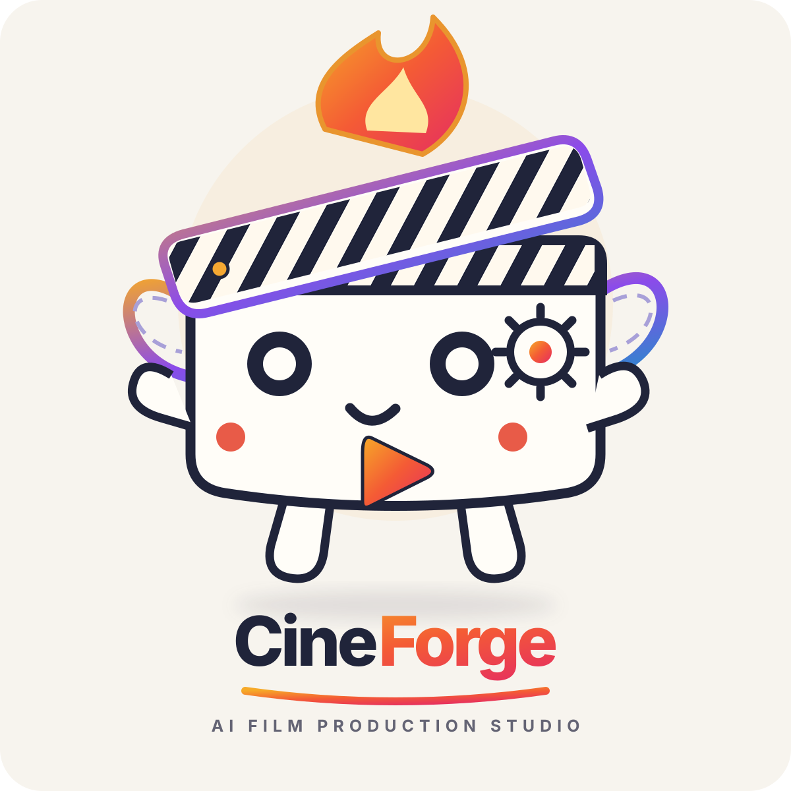
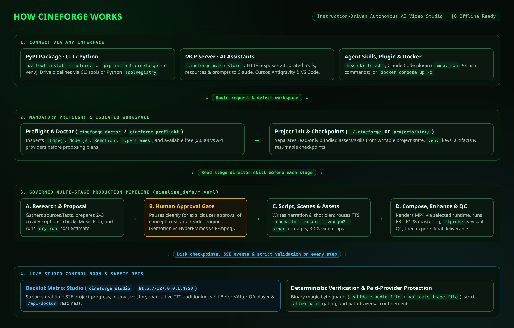
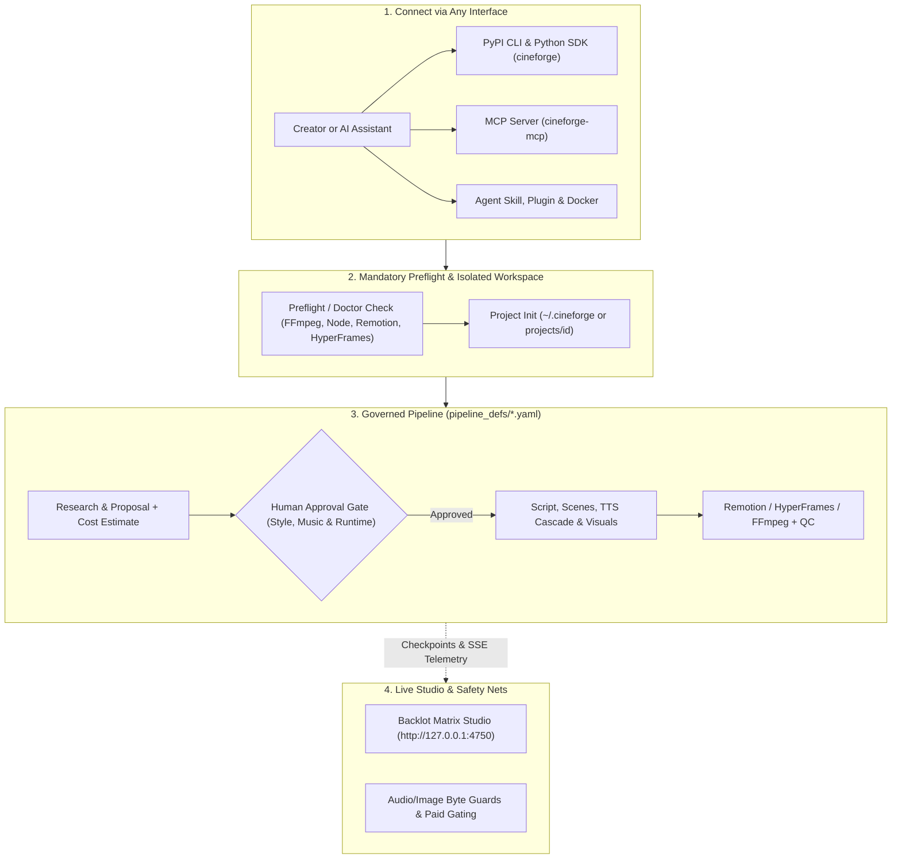
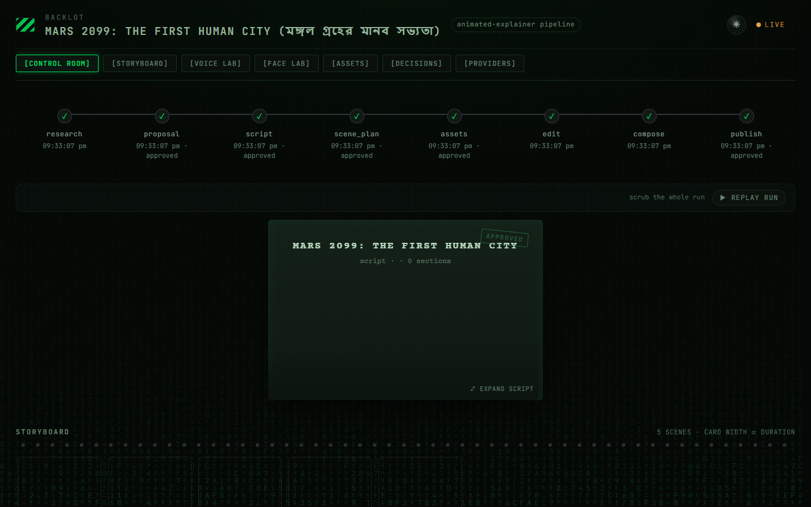
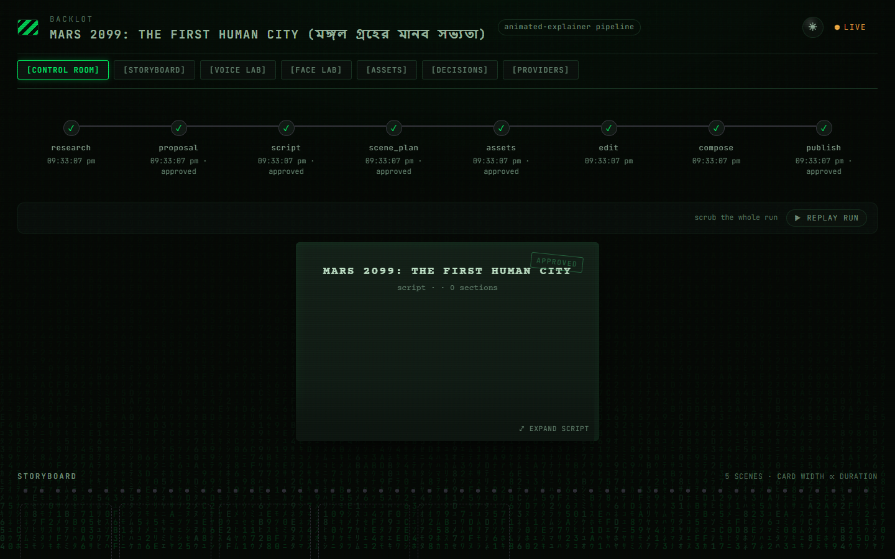
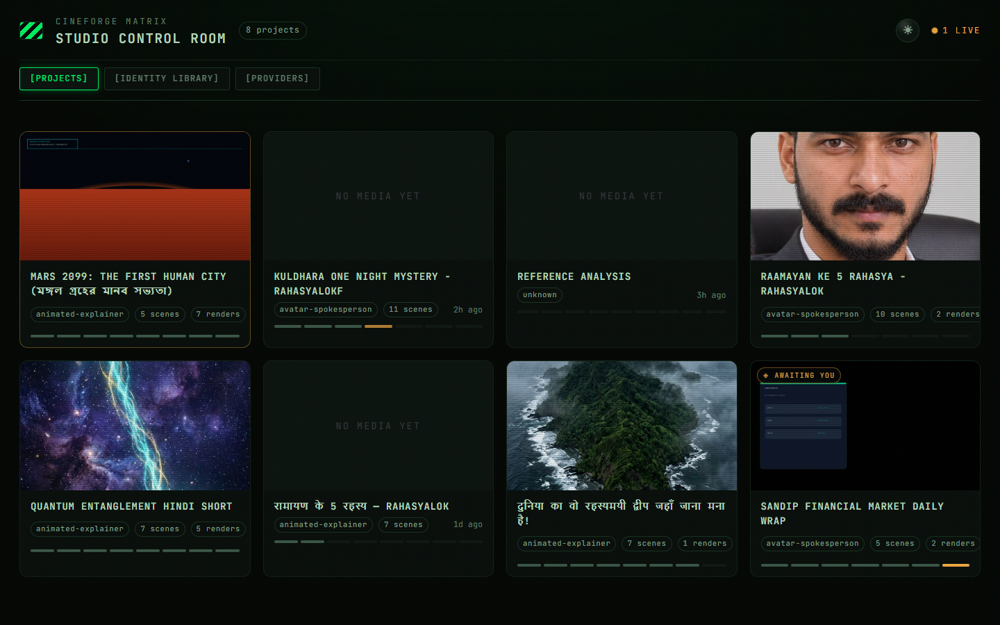

<p align="center">
  <picture>
    <source media="(prefers-color-scheme: dark)" srcset="https://raw.githubusercontent.com/mrsandipmandal/CineForge/main/assets/cineforge-dark.svg">
    
  </picture>
</p>

<p align="center"><sub><em>Monty the Clapper — the official mascot of CineForge</em></sub></p>

<h1 align="center">CineForge Matrix Studio</h1>

<p align="center"><strong>Autonomous AI Film & Video Production System</strong></p>
<p align="center"><em>Turn your AI assistant into an end-to-end film studio: research, scripting, character consistency, voice cloning, motion editing, and final composition.</em></p>

<p align="center">
  <a href="#-how-cineforge-works">🧠 How It Works</a> &nbsp;·&nbsp;
  <a href="#-whats-new-in-v020">🚀 What's New in v0.2.0</a> &nbsp;·&nbsp;
  <a href="#-quick-start--installation">⚡ Quick Start</a> &nbsp;·&nbsp;
  <a href="#-shortcuts--quick-commands-reference">⌨️ Shortcuts Cheat Sheet</a> &nbsp;·&nbsp;
  <a href="#-complete-documentation-index">📚 Documentation Index</a> &nbsp;·&nbsp;
  <a href="#-science-explainer-shorts--multi-language-autonomous-production">🔬 Science Explainer</a> &nbsp;·&nbsp;
  <a href="#-matrix-studio-control-room">🎛️ Control Room</a> &nbsp;·&nbsp;
  <a href="#-production-pipelines">🎬 Pipelines</a> &nbsp;·&nbsp;
  <a href="AGENT_GUIDE.md">🤖 Agent Guide</a>
</p>

<p align="center">
  <a href="LICENSE"></a>
  
  
  
  
  <a href="https://github.com/mrsandipmandal/CineForge/releases"></a>
</p>

<p align="center"><strong>Connect & Community</strong></p>

<p align="center">
  <a href="https://www.youtube.com/@CineForgeLab"></a>
  <a href="https://x.com/mr_sandipmandal"></a>
  <a href="https://github.com/mrsandipmandal/CineForge/discussions"></a>
</p>

---

## 🧠 How CineForge Works

<p align="center">
  
</p>

<details>
<summary><strong>View interactive Mermaid flowchart (GitHub)</strong></summary>



</details>

---

## ⚡ Quick Start & Installation

Get your studio up and running in **under 60 seconds**. No paid API keys are required to produce complete videos — CineForge ships with free offline neural TTS (Piper/Edge), open-source stock indexing, and local FFmpeg/Remotion compositing engines out of the box.

### Prerequisites

| Tool | Version | Purpose | Installation |
| :--- | :---: | :--- | :--- |
| **Python** | `3.10 – 3.12` | Studio engine, tool registry & pipelines | [python.org](https://www.python.org/downloads/) |
| **FFmpeg** | `6.0+` | Video encoding, Ken-Burns, audio synthesis | `sudo apt install ffmpeg` / `brew install ffmpeg` / [ffmpeg.org](https://ffmpeg.org/download.html) |
| **Node.js** | `20+` | Remotion React & HyperFrames motion engines | [nodejs.org](https://nodejs.org/) |
| **Git** | Any | Repository management & version control | [git-scm.com](https://git-scm.com/) |

---

### Choose Your Installation & Usage Method

| Method | Best For | Workspace Location | Key Advantage |
| :--- | :--- | :--- | :--- |
| **Option A: PyPI (`uv` / `pip`)** | Everyday creators, CLI & MCP users | `~/.cineforge` | Clean global install; no Git clone needed |
| **Option B: Agent Skill / Plugin** | Antigravity, Claude Code, Cursor, Codex | Current project folder | Teach any AI assistant in seconds |
| **Option C: Docker Compose** | Zero-setup isolation, servers & teams | `./workspace` | FFmpeg, Node.js, Remotion & HyperFrames pre-bundled |
| **Option D: 1-Command Installer** | Fresh Linux / macOS / Windows machines | `~/.cineforge` | Installs `uv`, `cineforge`, workspace & runs diagnostics |
| **Option E: Git Clone** | Contributors & custom tool development | Cloned repo folder | Editable source, local tests (`make test-contracts`) |

---

### Option A: PyPI Package (`uv` / `pip`) — CLI, Backlot UI & MCP Server (Recommended)

#### 1. Install
Use [`uv`](https://docs.astral.sh/uv/) (recommended — handles isolation automatically and installs global `cineforge`, `cineforge-mcp`, and `backlot` commands with no manual `venv` activation):

```bash
uv tool install cineforge
# With optional local voice / transcription / extra packs:
# uv tool install "cineforge[tts,whisper]"
```

Or install with `pip` inside a virtual environment:

```bash
python3 -m venv ~/.venvs/cineforge
source ~/.venvs/cineforge/bin/activate   # Windows: .\.venvs\cineforge\Scripts\Activate.ps1
pip install cineforge
```

> **Note for Ubuntu 24.04+ / Debian Linux (PEP 668):** System Python blocks bare `pip install cineforge` outside a virtual environment (`externally-managed-environment`). Use `uv tool install cineforge` (recommended) or activate a `venv` first before running `pip install cineforge`.

#### 2. How to Use (CLI & Backlot Control Room)
```bash
# 1. Guided setup (initializes ~/.cineforge, optional API keys, Remotion, Piper TTS, HyperFrames)
cineforge setup

# 2. Check FFmpeg, Node.js, render runtimes, and ready AI providers
cineforge doctor
cineforge doctor --json

# 3. Inspect available production pipelines and tools
cineforge pipelines list
cineforge pipelines show animated-explainer
cineforge tools list
cineforge tools info openaifm_tts

# 4. Run a tool directly (or --dry-run to check cost/status without writing media)
cineforge tools run tts_selector --input '{"text":"Hello from CineForge","output_path":"hello.wav"}'

# 5. List and render zero-key showcase demos
cineforge demo --list
cineforge demo code-to-screen

# 6. Launch Backlot Control Room in your browser (http://127.0.0.1:4750)
cineforge studio
```

#### 3. How to Use with AI Assistants via MCP (`cineforge-mcp`)
Connect CineForge as an MCP server so your AI assistant can inspect providers, initialize projects, generate narration/images/video, and render compositions without cloning the repo:

```bash
# Auto-configure your AI client (creates a backup if a config file already exists)
cineforge mcp install --client claude       # Also: claude-code | cursor | antigravity | windsurf | vscode | all

# Preview the config path & JSON without writing:
cineforge mcp install --client cursor --dry-run

# Or print ready-to-paste JSON for zero-install uvx launching:
cineforge mcp config --client claude --uvx
```

Manual server run options:
```bash
cineforge-mcp                                                       # stdio (default for desktop clients)
cineforge-mcp --transport streamable-http --host 127.0.0.1 --port 8766
cineforge-mcp --all-tools                                           # expose every BaseTool individually
cineforge-mcp --profile tts,image_generation                        # expose specific tool families only
```

Once connected, prompt your AI assistant naturally (or trigger MCP prompts `onboarding`, `make_video`, `science_explainer`):
- `"Run CineForge preflight and make a 60-second explainer about black holes."`
- The MCP server routes calls through `cineforge_preflight`, `cineforge_init_project`, `cineforge_get_stage_guide`, `cineforge_generate_tts`/`_image`/`_video`/`_music`, `cineforge_compose_video`, and `cineforge_open_backlot`.

---

### Option B: Portable Agent Skill & Claude Code Plugin (Any Project Folder)

#### 1. Install
Add the portable `cineforge` skill into any workspace (Antigravity, Claude Code, Cursor, Codex):

```bash
# Option B1: Using skills.sh
npx skills add mrsandipmandal/CineForge --skill cineforge

# Option B2: Using the CineForge CLI (from PyPI or local install)
cineforge skills list
cineforge skills install --target all --project-dir .
# Targets: agents | claude | cursor | codex | antigravity | all
# Use --global for user-wide installation, or --minimal for the core entry skill only.
```

For **Claude Code Plugin Marketplace**, use this repository's `.claude-plugin/marketplace.json` and `.claude-plugin/plugin.json`, which bundle `.agents/skills`, slash commands (`/animated-drawing`, `/backlot`, `/ink-art`), and `.mcp.json` (`uvx cineforge-mcp`).

#### 2. How to Use
1. Open the target project folder in **Antigravity**, **Claude Code**, **Cursor**, or **Codex**.
2. Ask your AI assistant directly:
   - `"Make a 60-second YouTube Short about deep sea bioluminescence using CineForge."`
   - `"বিজ্ঞান ভিডিও বানাও"` (triggers Bengali Science Explainer workflow)
   - Or invoke a slash command such as `/backlot`, `/animated-drawing`, or `/ink-art`.
3. The skill automatically detects whether **MCP tools**, **`cineforge` CLI**, or a **local repo checkout** is available, runs `preflight`/`doctor` first, and walks you through proposal, cost approval, and Backlot preview.

---

### Option C: Zero-Dependency Docker Studio (`studio` + `mcp`)

Pre-bundles Python 3.12, FFmpeg, Node.js 22, Remotion, HyperFrames, and `cineforge[all]`.

#### 1. Start Containers
```bash
git clone https://github.com/mrsandipmandal/CineForge.git
cd CineForge

# Optional: add API keys to .env (or pass env vars); $0.00 offline/free providers work without keys
docker compose up -d
```

#### 2. How to Use
- **Backlot Studio Web UI:** open `http://127.0.0.1:4750` in your browser.
- **Streamable-HTTP MCP Server:** connect your MCP client to `http://127.0.0.1:8766/mcp`.
- **Run CLI Commands Inside Container:**
  ```bash
  docker compose exec studio cineforge doctor
  docker compose exec studio cineforge demo --list
  docker compose exec studio cineforge pipelines list
  ```
- **Persistent Files:** generated projects, `.env`, and workspace assets are stored on the host under `./workspace`.
- **Stop Containers:** `docker compose down`

---

### Option D: 1-Command Terminal Installer

#### 1. Install
```bash
# Linux / macOS / WSL
curl -fsSL https://raw.githubusercontent.com/mrsandipmandal/CineForge/main/scripts/install.sh | bash
```

```powershell
# Windows PowerShell
irm https://raw.githubusercontent.com/mrsandipmandal/CineForge/main/scripts/install.ps1 | iex
```

#### 2. What It Does & How to Use
The installer automatically installs `uv` (if missing), installs `cineforge` globally, initializes `~/.cineforge` (`projects/`, `.env`, `config.yaml`), and runs `cineforge doctor`. Afterward, run:

```bash
cineforge setup                         # Configure optional API keys & Remotion/Piper runtimes
cineforge mcp install --client claude   # Connect Claude Desktop (or cursor/antigravity/vscode/all)
cineforge skills install --target all   # Install portable AI agent skills into a project
cineforge studio                        # Launch Backlot Control Room at http://127.0.0.1:4750
```

*(Need a custom workspace folder? Set `CINEFORGE_HOME=/path/to/workspace` or pass `--workspace /path/to/workspace` to `cineforge`.)*

---

### Option E: Clone Repository Setup (Contributors & Local Dev)

#### 1. Install
```bash
# Clone the repository
git clone https://github.com/mrsandipmandal/CineForge.git
cd CineForge

# One-command automated environment setup (venv, python packages & remotion engine)
make setup
```

<details>
<summary><strong>Manual Setup Alternative (macOS / Linux / WSL)</strong></summary>

```bash
# 1. Create and activate virtual environment
python3 -m venv .venv
source .venv/bin/activate

# 2. Install Python packages & dev tools
pip install --upgrade pip
pip install -e ".[dev]"
pip install piper-tts

# 3. Install Remotion composer engine
cd remotion-composer && npm install && cd ..

# 4. Copy environment configuration
cp .env.example .env
```
</details>

<details>
<summary><strong>Manual Setup Alternative (Windows PowerShell)</strong></summary>

```powershell
# 1. Create and activate virtual environment
py -3 -m venv .venv
.\.venv\Scripts\Activate.ps1

# 2. Install Python dependencies
pip install --upgrade pip
pip install -e ".[dev]"
pip install piper-tts

# 3. Install Remotion composer engine
cd remotion-composer; npm install; cd ..

# 4. Copy environment configuration
Copy-Item .env.example .env
```
</details>

#### 2. How to Use from a Local Repo Checkout
```bash
# Activate local virtualenv
source .venv/bin/activate

# Check tools & engines
cineforge doctor

# Launch Backlot Control Room (http://127.0.0.1:4750)
python -m backlot open

# Render showcase demos or run automated tests
make demo
make test-contracts
pytest tests/backlot/ tests/cli/ tests/mcp/ tests/packaging/ -q
```
Or open the cloned folder directly in **Antigravity**, **Claude Code**, **Cursor**, or **Codex**—[`AGENTS.md`](AGENTS.md) and [`AGENT_GUIDE.md`](AGENT_GUIDE.md) automatically guide the assistant.

---

### Step 2: Configure Keys (Optional — $0.00 Mode Works Immediately)

Every paid API key is optional. The studio functions offline with free neural TTS and open media:

```bash
# PyPI / 1-command installer workspace: edit ~/.cineforge/.env (or run `cineforge setup`)
# Local repo checkout: edit .env
nano ~/.cineforge/.env   # or .env in repo root

# Recommended additions:
# ELEVENLABS_API_KEY=your_key   # Studio voice cloning & SFX
# FAL_KEY=your_key              # FLUX.1/FLUX.2 image models & Kling/Veo video
# PEXELS_API_KEY=your_key       # Free HD stock footage library
```

---

### Step 3: Launch Backlot Control Room

```bash
# Start Backlot Matrix Studio server and launch browser at http://127.0.0.1:4750
cineforge studio
# Or from a local repo checkout:
# python -m backlot open
```

---

## 🛠️ Concrete Examples by Method

Below are real copy-pasteable workflows for every way CineForge can be run:

### 1. CLI Example (`cineforge`)
Check your environment, render a zero-key demo video, run free neural TTS directly, and inspect your board:

```bash
# 1. Verify FFmpeg, Node.js, Remotion, HyperFrames, and free providers
cineforge doctor

# 2. Render one of the bundled zero-key Remotion showcase demos
cineforge demo --list
cineforge demo world-in-numbers

# 3. Preview cost/status before execution (--dry-run), then synthesize speech audio
cineforge tools run tts_selector \
  --input '{"text":"Welcome to CineForge Studio.","output_path":"intro.wav"}' \
  --dry-run

cineforge tools run tts_selector \
  --input '{"text":"Welcome to CineForge Studio.","output_path":"intro.wav"}'

# 4. Inspect a pipeline specification as JSON
cineforge pipelines show animated-explainer

# 5. Open Backlot Studio UI in your browser (http://127.0.0.1:4750)
cineforge studio
```

### 2. MCP Server Example (`cineforge-mcp`)
Configure your AI editor automatically, or paste the generated JSON into your client's MCP config:

```bash
# Auto-install MCP config into Claude Desktop, Cursor, Antigravity, or VS Code
cineforge mcp install --client claude
cineforge mcp install --client cursor --uvx
```

Generated client config (`cineforge mcp config --client claude --uvx`):
```json
{
  "mcpServers": {
    "cineforge": {
      "command": "uvx",
      "args": ["--from", "cineforge", "cineforge-mcp"],
      "env": {
        "CINEFORGE_HOME": "~/.cineforge"
      }
    }
  }
}
```

Then ask your AI assistant in chat:
> *"Run CineForge preflight, initialize a project named `space-telescope` using `animated-explainer`, generate narration audio and 16:9 visuals, and compose a 45-second video."*

Behind the scenes, the assistant calls these curated MCP tools:
1. `cineforge_preflight()` — checks available runtimes (`ffmpeg`, `remotion`, `hyperframes`) and free/paid providers
2. `cineforge_init_project(project_id="space-telescope", title="Space Telescope", pipeline_type="animated-explainer", open_board=True)`
3. `cineforge_get_stage_guide(pipeline="animated-explainer", stage="script")`
4. `cineforge_generate_tts(text="...", output_path="projects/space-telescope/assets/narration.wav")`
5. `cineforge_generate_image(prompt="...", output_path="projects/space-telescope/assets/scene1.png", aspect_ratio="16:9")`
6. `cineforge_compose_video(edit_decisions={...}, asset_manifest={...}, output_path="projects/space-telescope/final.mp4", render_runtime="remotion")`
7. `cineforge_open_backlot(project_id="space-telescope")`

### 3. Portable Agent Skill & Claude Code Plugin Example
Install the `cineforge` skill into any standalone project folder (even outside this repository):

```bash
mkdir ~/my-video-workspace && cd ~/my-video-workspace

# Install via skills.sh or cineforge CLI
npx skills add mrsandipmandal/CineForge --skill cineforge
# Or install all IDE skill formats + Claude slash commands locally:
cineforge skills install --target all --project-dir .
```

Now open `~/my-video-workspace` in **Antigravity**, **Claude Code**, **Cursor**, or **Codex**, and prompt:
```text
Make a 60-second YouTube Short explaining how black holes evaporate using CineForge.
```
Or run installed slash commands such as `/backlot`, `/animated-drawing`, or `/ink-art`.

### 4. Docker Studio & Remote Streamable-HTTP MCP Example
Run everything (Python 3.12, FFmpeg, Node 22, Remotion, HyperFrames) inside containers with persistent host storage:

```bash
git clone https://github.com/mrsandipmandal/CineForge.git && cd CineForge
docker compose up -d

# Check container studio readiness
docker compose exec studio cineforge doctor

# Inspect generated or mounted workspace files on the host under ./workspace
ls -la ./workspace
```

- **Studio UI:** `http://127.0.0.1:4750`
- **Remote/Local HTTP MCP Endpoint:** `http://127.0.0.1:8766/mcp` (started automatically by the `mcp` service in `docker-compose.yml`).
- **Standalone HTTP MCP CLI (without Docker):**
  ```bash
  cineforge-mcp --transport streamable-http --host 127.0.0.1 --port 8766
  ```

### 5. Python API Example (Programmatic Usage / Contributors)
Use CineForge's checkpoint and tool registry modules directly from Python (inside your `venv` or repo `.venv`):

```python
from lib.checkpoint import init_project
from tools.tool_registry import ToolRegistry

# 1. Initialize a tracked workspace project under projects/
init_project(
    "solar-eclipse-short",
    title="Solar Eclipse Explained",
    pipeline_type="animated-explainer",
)

# 2. Discover tools and inspect free provider readiness
registry = ToolRegistry()
registry.discover()
print(registry.provider_menu_summary()["capabilities"])

# 3. Execute speech synthesis via TTSSelector (uses free/offline cascade by default)
tts = registry.get("tts_selector")
res = tts.execute({
    "text": "Today we explore why total solar eclipses happen.",
    "output_path": "projects/solar-eclipse-short/narration.wav",
})
print(res.success, res.artifacts)
```

---

<a id="-whats-new-in-v020"></a>
## 🚀 What's New in v0.2.0

CineForge **v0.2.0** introduces cinematic 2.5D animation, a non-destructive pre-export enhancement suite, Google Veo 2 video integration, high-fidelity neural voice cloning with VoxCPM2, and autonomous creator skills.

### 🎬 1. 2.5D Multi-Frame Cinematic Motion Engine
- **Multi-Plane Camera Choreography** (`tools/video/cinematic_motion_animator.py`): Transforms static AI image plates into living cinematic shots with programmatic 3D parallax depth, camera zooms, subtle panning, dynamic camera shakes, and depth-of-field blur.
- **Atmospheric Particle Shaders**: Generates procedural ambient lighting, floating dust motes, blazing embers, and divine rays calibrated to narrative emotional beats.
- **Render Timeout Governance**: Added `remotion_timeout_ms` (120s default with graceful fallback) to ensure complex 4K compositions never abort prematurely.

### ✨ 2. Pre-Export Enhancement Suite & Backlot Split-Screen Inspection
- **Video Quality Enhancer** (`tools/enhancement/video_quality_enhancer.py`): Non-destructive post-compose pipeline running FFmpeg Lanczos / RealESRGAN upscaling, `hqdn3d` temporal denoising, unsharp contrast sharpening, and automatic aspect ratio preservation.
- **AI Human Enhancer** (`tools/enhancement/ai_human_enhancer.py`): Identity-preserving face restoration and lighting correction with automated `FaceTracker` (bypasses landscapes and diagrams to save compute without hallucinations).
- **Backlot Dual-Player (`⇄ Compare Before / After`)**: Side-by-side synchronized video inspection inside Backlot Matrix Studio to inspect quality improvements prior to publishing approval.

### 🎙️ 3. Next-Gen Voice Synthesis & Voice Cloning Fleet
- **VoxCPM2 44.1kHz Zero-Shot Voice Cloning** (`tools/audio/voxcpm2.py`): Cloud GPU (Kaggle/remote) worker integration enabling voice cloning from reference audio with zero local VRAM overhead.
- **Expanded Neural TTS Fleet**:
  - **Kokoro-82M TTS** (`tools/audio/kokoro_tts.py`): Lightning-fast local neural voice synthesis.
  - **OpenAI.fm TTS** (`tools/audio/openaifm_tts.py`): High-expressivity multi-accent speech.
  - **OpenRouter Free Audio Gateway** (`tools/audio/openrouter_tts.py`): Multi-model zero-cost audio inference.
  - **Dhee IndicF5 TTS** (`tools/audio/dhee_indicf5_tts.py`): High-fidelity regional Indian voice cloning.
- **Sandip Studio Audio Master** (`tools/audio/sandip_audio_master.py`): Broadcast-standard EBU R128 (-14 LUFS) mastering chain with 3-band parametric EQ, gentle dynamic compression, and gating.

### 🎥 4. Google Veo 2 Integration
- **Direct Gemini API & Vertex AI Routing** (`tools/video/veo_video.py`): Native auto-detection of `GEMINI_API_KEY` / `GOOGLE_API_KEY` for Google DeepMind's flagship Veo 2 generative video model, with seamless fallback to fal.ai and Kling.

### 🤖 5. Autonomous Creator Skills Fleet
- **`ai-video-editor`**: Autonomous talking-head video editing with local Whisper silence/mistake trimming and code-drawn Nafay 3D motion graphics in 7 visual styles.
- **`stream-clips`**: High-energy game stream & VOD clipper with 9:16 stacked facecam/gameplay layout and synced word-by-word subtitles.
- **`faceless-shorts`**: 100% code-driven vertical viral shorts at $0 compute cost.
- **Mythological Video Authenticity Engine**: Guidelines for Sanskrit Devanagari mantra verification, Vedic attire, and sacred iconography.

### 🛡️ 6. Security Hardening & CI/CD
- **Zero Path Traversal Vulnerabilities**: Hardened API route sanitization in Backlot server and skill preview endpoints; passed GitHub CodeQL security analysis.
- **Strict Media Integrity Validators**: Automated binary magic-byte checks (`validate_image_file` and `validate_audio_file`) preventing corrupted or empty payload leaks.

---

## ⌨️ Shortcuts & Quick Commands Reference

Keep this cheat sheet handy to control your studio from the command line or any AI coding IDE:

### 🛠️ Terminal & CLI Shortcuts

| Shortcut / Command | Action |
| :--- | :--- |
| `cineforge setup` | Interactive guided setup (workspace, optional API keys, Remotion, Piper) |
| `cineforge doctor` | Check FFmpeg, Node.js, Remotion, HyperFrames, and provider availability |
| `cineforge studio` | Launch the Backlot Matrix live control room in your default browser |
| `cineforge demo` | Render zero-key Remotion showcase demos into `projects/demos/renders/` |
| `cineforge mcp install --client claude` | Auto-configure CineForge MCP in Claude Desktop, Cursor, Antigravity, or VS Code |
| `cineforge skills install --target all` | Install portable CineForge AI skills & commands into any project or IDE |
| `cineforge-mcp` | Start the Smart Hybrid CineForge MCP server (`stdio` or `--transport streamable-http`) |
| `docker compose up -d` | Start pre-bundled Studio + HTTP MCP containers with FFmpeg & Node 22 |
| `make setup` | Complete 1-click repo install (venv, Python packages, Remotion dependencies) |
| `python -m backlot open` | Launch the Backlot Matrix live control room in your default browser |
| `python -m backlot open <project-id>` | Open live monitoring for a specific production workspace |
| `make demo` | Render all three zero-key showcase demos instantly |
| `./render-demo.sh world-in-numbers` | Render the 45s data-visualization explainer demo |
| `make test-contracts` | Run contract tests across all 175 production tools (zero API spend) |
| `pytest tests/ -v` | Execute full test suite (1,308 verified tests) |
| `python -m backlot.server` | Start the Backlot backend daemon on port `4750` (or `8765`) |

---

### 💬 AI Agent Prompt Shortcuts (Universal IDE Access)

Copy and paste these directly into **Google Antigravity**, **Claude Code**, **Cursor**, **Windsurf**, or **GitHub Copilot**:

| Prompt Shortcut | Target Deliverable | Workflow Triggered |
| :--- | :--- | :--- |
| `"make a science video"` | 9:16 / 16:9 Mystery Short | Dynamic language Q&A → Live web research → Top-6 topics → 1-gate approval |
| `"বিজ্ঞান ভিডিও বানাও"` | 9:16 Bengali Science Short | Native Bengali voiceover (`bn-IN`), deep-sea/physics CGI, Nirmala UI subtitles |
| `"/science-explainer"` | Multi-Language Explainer | Launches interactive Science Explainer Shorts skill (`bengali-science-explainer`) |
| `"Here is a YouTube Short: <URL>. Make something like this about <Topic>"` | Reference-Led Short | Runs `video_analyzer` transcript & pacing extraction → Proposes 3 distinct treatments |
| `"Make a 60-second animated explainer about <Topic>"` | 1080p Animated Explainer | `animated-explainer` pipeline with Remotion kinetic cards and diagrams |
| `"Repurpose this podcast file <audio.mp3> into 5 viral shorts"` | Social Clip Pack | `clip-factory` pipeline with WhisperX transcription and TikTok-style word highlights |
| `"Make a historical documentary about <Event> with zero API cost"` | Archival Documentary | `documentary-montage` searching NASA, Archive.org, and Wikimedia Commons |

---

## 📚 Complete Documentation Index

| Guide | Description | Key Topics |
| :--- | :--- | :--- |
| [**Science Explainer Shorts Guide**](docs/SCIENCE_EXPLAINER.md) | Multi-language mystery & science video generator | 8+ neural languages, platform safe zones, ASS styling |
| [**Agent Operating Contract**](AGENT_GUIDE.md) | Mandatory agent protocols and execution rules | Preflight checks, decision logging, human approval gates |
| [**Shared Project Context**](PROJECT_CONTEXT.md) | Single source of truth for repository conventions | 3-layer knowledge system, tool catalog, pipeline state |
| [**Tested Prompt Gallery**](PROMPT_GALLERY.md) | Proven prompts producing broadcast-ready videos | Science shorts, data explainers, zero-key demos |
| [**AI Providers Matrix & Pricing**](docs/PROVIDERS.md) | Detailed comparison of 60+ generative models | Video, image, voice models, cost per minute & quotas |
| [**Voice Identity Studio**](docs/VOICE_IDENTITY.md) | Multilingual voice setup & reference cloning | Sarvam AI, Edge TTS, Piper, voice consent verification |
| [**Face & Character Identity**](docs/FACE_IDENTITY.md) | Persistent character consistency across cuts | Multi-angle character packs, LoRA bundles, seed locks |
| [**Matrix Studio UI System**](docs/MATRIX_UI.md) | Terminal control room design architecture | Cyberpunk CRT theme, SSE event stream, telemetry |
| [**Identity Library Architecture**](docs/IDENTITY_LIBRARY.md) | Persistent voice and actor profiles | Central asset repository layout and JSON schemas |
| [**Upgrade & Migration Guide**](docs/UPGRADE_MIGRATION.md) | Upgrading from legacy CineForge/OpenMontage | Breaking changes, manifest migrations, runtime adapters |

---

<a id="science-explainer-shorts--multi-language-autonomous-production"></a>
## 🔬 Science Explainer Shorts — Multi-Language Autonomous Production

CineForge includes an interactive, end-to-end production workflow for **Science Mystery Shorts, Nature Curiosities, and Educational Viral Videos**. It combines dynamic real-time web research, high-impact scriptwriting, AI imagery, 3D Ken-Burns camera movement, acoustic ambient synthesis, and burned kinetic typography — with **zero required API keys ($0.00 compute cost)**.

```
"make a science video" ──▶ Dynamic Language ──▶ Live Web Research ──▶ AI-Scored Top 6 Topics
                                                                             │
                                                                             ▼
Final Broadcast MP4 ◀── Full Pipeline ◀── Single Human Approval ◀── Interactive Feature Menu
 (Shorts/Reels 1080p)    (Images/TTS/Mix)    ("Approved!")          (Format, Style, Tone)
```

### Key Workflow Highlights

1. **Dynamic Language Selection**: The studio asks for your preferred language first, then switches **all subsequent user interaction, narration, script, and subtitles** into that language immediately. Supported out of the box: English, Bengali (বাংলা), Hindi (हिन्दी), Spanish (Español), French (Français), German (Deutsch), Arabic (العربية), Japanese (日本語), and more.
2. **AI-Led Trend & Fact Research**: Silently browses current scientific publications and viral anomalies, scoring candidates by *surprise factor*, *visual potential*, and *viewer retention* before proposing the top 6 concepts.
3. **Interactive Feature Menu (1 Message)**: Configure video format (9:16 vertical Short, 16:9 landscape, 1:1 square), aesthetic art direction (Photorealistic CGI, Nature Doc, Flat Vector, Dark Noir), narrator tone, video duration (45s, 60s, 90s), and soundscape in a single response (or reply `"all default"`).
4. **Transparent Production Plan & 1-Gate Approval**: Inspect the 5-scene breakdown, script preview, asset map, exact runtime, and cost breakdown before compute begins. Once approved, the agent runs research, scripting, image generation, audio synthesis, subtitles, and final FFmpeg assembly autonomously without interruptions.

### Supported Video Platforms & Technical Pacing

| Platform | Format | Resolution | Optimal Length | Pacing & Algorithmic Optimization |
| :--- | :---: | :---: | :---: | :--- |
| **YouTube Shorts** | `9:16` | 1080×1920 | 50–60s | 3s visual cliffhanger, centered subtitles with 170px bottom safety margin |
| **Instagram Reels** | `9:16` | 1080×1920 | 60–75s | Aesthetic 3D CGI visuals, crisp contrast typography, explore feed reach |
| **TikTok** | `9:16` | 1080×1920 | 45–60s | High-energy curiosity hook, right-margin safe zone for interactive buttons |
| **Facebook Reels** | `9:16` | 1080×1920 | 60s | High universal appeal, family/nature mysteries, clear centered subtitles |
| **YouTube Standard** | `16:9` | 1920×1080 | 75–90s | Classical horizontal framing, deep documentary narration, playlist-ready |
| **Instagram Feed** | `1:1` | 1080×1080 | 45–60s | Balanced square composition, high contrast typography |
| **Snapchat Spotlight** | `9:16` | 1080×1920 | 30–45s | Fast dopamine pace, 220px bottom margin for UI buttons |
| **Pinterest Idea Pins** | `9:16` | 1080×1920 | 45–60s | Evergreen educational value, step-by-step visual clarity |
| **LinkedIn Video** | `16:9` | 1920×1080 | 60s | Innovation angle, high-readability professional subtitles |
| **X / Threads** | `9:16` / `16:9` | 1080×1920 | 45–60s | Viral cliffhanger, instant curiosity hook in first 2 seconds |

> 📖 **Full Guide & Interactive Documentation**: See [`docs/SCIENCE_EXPLAINER.md`](docs/SCIENCE_EXPLAINER.md) for full voice registries, ASS subtitle templates, FFmpeg zoompan mathematics, and sample sessions.

---

## 🎛️ Matrix Studio Control Room

**Backlot Matrix Edition** (`http://127.0.0.1:4750/`) provides real-time telemetry, visual approval gates, asset contact sheets, and persistent identity registries in a cyberpunk green-on-black terminal UI (`#030804` background, `#00ff66` phosphor green accents, CRT scanlines, and animated digital rain).

### 1. Live Project Control Room (`/p/futuristic-mars-colony`)
Monitors pipeline stages in real time. Shows automated and human approval checkpoints, duration metrics, and complete stage state tracking across research, script, assets, edit, and composition:

<p align="center">
  
</p>

### 2. Visual Storyboard & Shot Planner (`/p/{project_id}#storyboard`)
Inspect generated visual scene plates, camera motion choreography (push-in, pan, dolly), subtitle timing, and prompt directions:

<p align="center">
  
</p>

### 3. Studio Multi-Project Dashboard (`/`)
Live bird's-eye view across all projects in the pipeline, tracking generation spend, render count, and stage progress:

<p align="center">
  
</p>

---

## 🎬 Production Studio Showcase

CineForge is an agent-first production system where plain language instructions drive verified, multi-stage pipelines:

### 1. Futuristic Mars Colonization 2099
Full animated sci-fi production featuring procedural 1080p Martian landscapes, geodesic biodomes, subterranean lava-tube transit, Sarvam AI native West Bengal Bengali (`bn-IN`) voice narration, and cinematic Ken-Burns motion choreography:

<div align="center">
  <video src="https://raw.githubusercontent.com/mrsandipmandal/CineForge/main/assets/futuristic-mars-colony.mp4" poster="https://raw.githubusercontent.com/mrsandipmandal/CineForge/main/assets/futuristic-mars-colony-poster.png" width="100%" controls autoplay loop muted></video>
  <p><sub><em>Rendered with CineForge Animated Explainer pipeline (1080p, 30fps) — Audio mix with Sarvam AI <code>bn-IN</code> TTS and ambient sci-fi synthesizer bed.</em></sub></p>
</div>

### 2. Matrix Studio Motion Title & Kinetic Typography
<div align="center">
  <video src="https://raw.githubusercontent.com/mrsandipmandal/CineForge/main/assets/cineforge-demo.mp4" poster="https://raw.githubusercontent.com/mrsandipmandal/CineForge/main/assets/cineforge-demo-poster.png" width="100%" controls autoplay loop muted></video>
  <p><sub><em>Rendered with CineForge Remotion engine (1080p, 30fps) — typography, layout, timing, and audio muxing generated via pipeline.</em></sub></p>
</div>

---

## 🌟 Core Capabilities & Use Cases

CineForge differs fundamentally from ordinary "single-prompt prompt-to-video" tools. It mirrors a professional production studio:

### 1. Reference-Driven Video Production
Paste any YouTube video, Short, TikTok, or Instagram Reel:
```text
"Here is a YouTube Short I love. Analyze its structure, pacing, and hooks, and make an original 60-second version about quantum computing."
```
The agent executes `video_analyzer`, extracts the transcript, breaks down scene pacing, and proposes **2-3 differentiated creative treatments** with clear cost projections.

### 2. Multi-Angle Character & Face Consistency
Create reusable characters in `sample-files/characters/` with multi-view portraits (`front`, `left_quarter`, `right_quarter`, `expression`). The system injects conditioning bundles into video models (Kling, Seedance, Wan2.1) so the same character appears consistently across different scenes, camera angles, and projects.

### 3. Multilingual Voice Studio & Offline Fallback (Bengali bn-IN, Hindi, English, Spanish, Arabic & More)
Native multi-language voice identity management with intelligent hardware profiling:
- **West Bengal Bengali (`bn-IN`)**: Sarvam AI (`bulbul:v3`), AI4Bharat IndicTTS (IIT Madras), and neural Edge TTS (`bn-IN-BashkarNeural`, `bn-IN-TanishaaNeural`) preserving authentic Indian Bengali phonetics, syntax, and cultural cadence.
- **Global Neural Voice Fleet (`edge_tts`)**: Instant zero-cost access to 400+ neural voices across 70+ languages (English, Hindi, Spanish, French, German, Japanese, Arabic) with micro-pitch and rate calibration.
- **Offline Hardware Routing**: Automated PC VRAM & core detection (`local_hardware_probe.py`) routes automatically between fast offline Piper TTS, medium IndicTTS, and high-fidelity IndicF5 based on local capacity.
- **Groq LPU Acceleration**: Sub-second scriptwriting and Whisper Large v3 audio transcription at 300+ tokens/sec.
- **OpenRouter Multi-Model Gateway**: Zero-cost access to state-of-the-art open weights (DeepSeek R1, Llama 3.3, Qwen) and xAI Grok.
- Supports reference-audio voice cloning (ElevenLabs, Fish Audio, IndicF5, Coqui XTTS) with mandatory actor consent verification (`consent_verified: true`).

### 4. Zero-Cost Real-Footage Documentaries
CineForge can build real documentaries without paying for generative video models:
- Searches and downloads high-resolution open archival footage from **Archive.org**, **NASA**, and **Wikimedia Commons**.
- Indexes footage with CLIP semantic embeddings and cuts a synchronized motion timeline with **Piper TTS** (offline local voice) and **FFmpeg**.

### 5. Automated Social Clip Factory
Feed in an hour-long podcast, interview, or lecture. The agent transcribes with WhisperX, scores moments for hook strength, trims optimal 30-60 second clips, adds TikTok-style word-level subtitles, and re-frames to 9:16 vertical video.

---

## 🪄 Universal Production Wizard & Cinematic Enhancers

CineForge introduces a unified production workflow connecting conversational intake, 3D cinematic scene specifications, and post-compose quality/human enhancement:

### 1. Universal Production Wizard (`lib/production_wizard.py`)
- **Progressive Intake**: Intelligently extracts duration, aspect ratio, style, and platform from user prompts and project context without asking repetitive questions.
- **4 Operational Modes**:
  - `Quick`: Streamlined 2-question path for rapid generation.
  - `Guided`: Context-rich choices with short explanations for general creators.
  - `Advanced`: Full access to provider routing, model selection, and budget caps.
  - `Expert`: Low-level access to render parameters, filter chains, and resolution targets.
- **Mandatory Duration Bands**: Exactly 7 choices (`15–30 seconds`, `30–60 seconds`, `1–3 minutes`, `3–5 minutes`, `5–10 minutes`, `Custom`, `Skip — Let AI Decide`).
- **Auditable AI Decision-Making**: When the user delegates with "Skip — Let AI Decide", the agent records auditable reasoning, constraints, and confidence in `decision_log.json`, never silently incurring unexpected charges.

### 2. Cinematic Animation Engine Integration (`lib/cinematic_scene_spec.py`)
- **Backend-Agnostic Scene Spec**: Maps high-level narrative beats into geometric world models (`terrain_type`, `fog_density`, `lighting_preset`, `camera_path`, `atmosphere`).
- **Validated Multi-Renderer Dispatch**:
  - **Three.js Semantic Worlds**: In-browser WebGL blockouts and production-fidelity GLTF scenes validated by `ThreeJSWorld`.
  - **Blender 4.5+ LTS Worlds**: Production camera trajectories, terrain generation, and Eevee Next rendering via `BlenderWorld`.
  - **ManimCE AST Scanner**: Safe mathematical animations with AST security filters.

### 3. Video Quality Enhancer (`tools/enhancement/video_quality_enhancer.py`)
- **Non-Destructive Post-Compose Stage**: Enhances rendered compositions immediately before export and publishing while strictly preserving the original raw render.
- **Tuned Profiles**: `gentle`, `balanced`, `cinematic`, `maximum`, `custom`, and `disabled`.
- **Comprehensive Processing**: FFmpeg Lanczos / RealESRGAN upscaling, hqdn3d denoising, unsharp contrast sharpening, and automatic aspect ratio preservation.
- **Verification & Reports**: Emits schema-validated `enhancement_report` artifacts with probe metrics, bitrate changes, and decodability checks.

### 4. AI Human Enhancer (`tools/enhancement/ai_human_enhancer.py`)
- **Identity-Preserving Subject Polish**: Face restoration, skin smoothing, eye clarity enhancement, and lighting balance.
- **Automatic Face Detection & Safety Bypass**: Employs `FaceTracker` to detect human subjects. If no faces are present (e.g. landscapes, abstract 3D worlds, diagrams), it marks `not_applicable`, avoids hallucination or compute costs, and passes the clean video through untouched.
- **Consent Enforcement**: Adheres to strict identity consent gates (`consent_verified: true`).

### 5. Backlot Split Before/After Inspection
- Interactive dual-video inspection and synchronized preview in the Backlot Studio (`⇄ Compare Before / After`), enabling instant side-by-side verification before final export approval.

---

## 🎬 Production Pipelines

Every video production request maps to an auditable pipeline manifest in `pipeline_defs/`:

```
research  →  proposal  →  script  →  scene_plan  →  assets  →  edit  →  compose  →  enhancement  →  publish
```

| Pipeline | Target Format | Primary Use Case |
| :--- | :--- | :--- |
| **`animated-explainer`** | 16:9 / 9:16 | Educational explainers, tech breakdowns, diagrams, voiceover |
| **`character-animation`** | 16:9 / 9:16 | 2D/3D character rigs, pose libraries, GSAP timelines, SVG acting |
| **`cinematic`** | 16:9 / 9:16 / 21:9 | Mythological epics, cinematic trailers, high-concept teasers, sci-fi/fantasy mood pieces |
| **`documentary-montage`** | 16:9 | Archival documentaries, historical essays (Archive.org, NASA, Wikimedia) |
| **`mythological_shorts`** | 9:16 | Fast-paced mythological & devotional shorts, kinetic Devanagari subtitles |
| **`talking-head`** | 9:16 / 16:9 | Presenter videos, SadTalker/Wav2Lip avatar sync, interviews |
| **`clip-factory`** | 9:16 | Batch repurposing long-form footage into ranked social clips |
| **`screen-demo`** | 16:9 | Polished software walkthroughs, cursor smoothing, terminal demos |

---

## 🌟 Key Features & New Updates

### 🎙️ 1. Multi-Tier TTS Priority & Intelligent Fallback Engine
- **Universal Provider Cascade**: Intelligently cascades across **Kokoro-82M** (ultra-fast offline neural), **OpenAI.fm**, **Piper TTS** (zero-key local), **Fish Audio** (S2-Pro expressive voices), **ElevenLabs**, and **Sarvam AI** (native Indic languages).
- **Automated Audio Byte Validator**: Every generated clip is verified before use: checking valid MP3/WAV headers, audio file size threshold, speech duration against script, and EBU R128 (-14 LUFS) broadcast loudness mastering.
- **Auto-Fallback Recovery**: If a cloud provider hits rate limits or network issues, the selector automatically routes down to the next priority tier without human intervention.

### 🎛️ 2. Backlot Living Storyboard & Control Room (`http://127.0.0.1:4750`)
- **Live SSE Storyboard Feed**: Pipeline stages light up in real time as AI agents research, script, generate assets, and composite renders.
- **TTS Priority & Voice Lab**: A dedicated studio view inside Backlot allowing live voice auditioning, manual vs. automatic priority ranking, and real-time test synthesis.
- **Defensive Multi-Format Poster Resolution**: Automatically surfaces thumbnails from `images/`, `thumbnails/`, and video keyframes directly to the Studio Control Room.

### 📐 3. Remotion 9:16 Vertical Video Composition Engine
- **Ken Burns Cinematic Motion**: Programmatic camera zooms, subtle panning, and smooth crossfades tuned to narrative beats.
- **Procedural VFX Canvas**: Custom React/Canvas layers including divine sunbeams, blazing fire embers, celestial lightning shockwaves, and falling lotus showers.
- **Glassmorphism Devanagari Typography**: Synchronized high-contrast bilingual subtitle cards with gold border accents and shadow drop for maximum mobile retention.

---

## 💡 Production Use Cases & Playbooks

1. **Epic Historical & Mythological Series (YouTube Shorts / Reels / TikTok 9:16)**
   - *Example*: **Ramayana Episodic Series** (5+ completed episodes, from Lord Rama's birth to Sita Swayamvar & Parashurama's Wrath).
   - Combines 8K bespoke mythological paintings, pure Sanskrit Devanagari mantras ("ॐ नमः शिवाय", "ॐ नमो नारायणाय"), and deep authoritative studio storytelling voiceover.
2. **Science & Mystery Explainer Documentaries**
   - Autonomous multi-language production (Bilingual Bengali/English).
   - Silent web research, AI-curated trending topic proposals, and single-gate user approval.
3. **Automated Social Clip Factory & Repurposing**
   - Transcribes long-form audio/video using local Whisper, detects high-hook moments, and crops into polished 9:16 shorts.
4. **Developer Walkthroughs & Synthetic Terminal Demos**
   - Smooth cursor animations, typed terminal sessions, and technical architectural walkthroughs.

---

## 🏗️ Architecture & Design Principles

```
CineForge Matrix/
├── tools/                 # 175 production tools (BaseTool subclasses)
│   ├── audio/             # Voice identity, TTS selector, audio mixer, Suno
│   ├── avatar/            # Character face identity, talking head, lip-sync
│   ├── video/             # Video generation, clip search, stitcher, trimmer
│   ├── graphics/          # FLUX, Imagen, Grok, diagrams, code snippets
│   ├── analysis/          # WhisperX transcriber, scene detector, frame sampler
│   └── enhancement/       # Face restoration (CodeFormer), upscale, background removal
│
├── sample-files/          # Identity Library: voices/, faces/, characters/, manifests/
├── pipeline_defs/         # Pipeline manifests (stages, tools, human approval gates)
├── skills/                # Stage director skills & quality review checklists
├── backlot/               # Backlot Matrix Studio (FastAPI, SSE change feed, Matrix UI)
├── remotion-composer/     # React / Remotion composition engine (1080p/4K video)
├── lib/                   # Checkpoints, pipeline loader, cost tracker, state machine
└── tests/                 # 1,308 contract tests, integration tests, security tests
```

### Core Architecture Rules:
1. **The AI Agent is the Director**: Orchestration logic lives in transparent, readable markdown instructions (`skills/pipelines/`). Python provides robust tools and state persistence.
2. **Deterministic Checkpointing**: Every stage saves to `projects/<name>/checkpoint_<stage>.json`. Productions can be resumed, replayed, or branched at any point.
3. **Auditable Decision Log**: Every provider selection, cost estimate, and visual style decision is logged with alternatives considered and confidence scores.
4. **Pre-Compose & Post-Render Quality Gates**: Automated validation stops broken plans before spending compute. Post-render self-review runs `ffprobe`, audio clipping checks, and frame analysis before presenting output.

---

## 🧪 Testing & Quality Assurance

CineForge includes an extensive automated test suite covering BaseTool contracts, identity library scanning, Backlot endpoints, and security boundaries:

```bash
# Run contract and library tests (zero API keys needed)
make test-contracts

# Run full test suite with coverage (1,308 passing tests)
pytest tests/ -v

# Run Backlot backend smoke tests
pytest tests/backlot/ -v
```

---

## 🌐 Community & Support

- **YouTube**: [@CineForgeLab](https://www.youtube.com/@CineForgeLab) — Video tutorials, production breakdowns, and showcase reels.
- **X (Twitter)**: [@mr_sandipmandal](https://x.com/mr_sandipmandal) — Developer updates, release announcements, and build notes.
- **GitHub Discussions**: [CineForge Discussions](https://github.com/mrsandipmandal/CineForge/discussions) — Ask questions, suggest new pipelines, and share generated films.
- **Issues**: [GitHub Issue Tracker](https://github.com/mrsandipmandal/CineForge/issues) — Report bugs or request tools.

<p align="center">
  <a href="https://www.buymeacoffee.com/sandiptaibt" target="_blank">
    
  </a>
</p>

---

## 📄 License

This project is licensed under the **Apache License 2.0**. See the [LICENSE](LICENSE) file for details.
