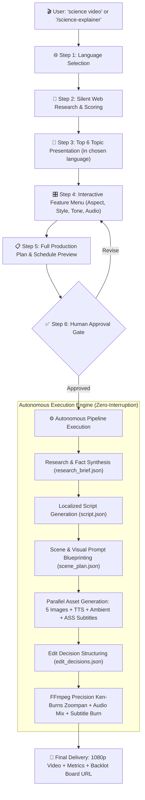

# Science Explainer Shorts — Multi-Language Autonomous Production

> **Turn any scientific curiosity or viral nature mystery into a broadcast-ready Short in minutes.**  
> Native multi-language voice narration, automated web research, AI visual generation, dynamic Ken-Burns camera motion, synthesized ambient soundscapes, and burned kinetic typography — with **zero required API keys ($0.00 compute cost)**.

---

## 📑 Table of Contents

1. [Overview & Philosophy](#overview--philosophy)
2. [Supported Platforms & Technical Specs](#supported-platforms--technical-specs)
3. [Supported Languages & Voice Registry](#supported-languages--voice-registry)
4. [End-to-End Production Workflow](#end-to-end-production-workflow)
5. [Interactive Configuration Matrix](#interactive-configuration-matrix)
6. [Pipeline Governance & Canonical Artifacts](#pipeline-governance--canonical-artifacts)
7. [Zero-Cost Tech Stack & Fallback Routing](#zero-cost-tech-stack--fallback-routing)
8. [IDE & Platform Integration (Universal Access)](#ide--platform-integration-universal-access)
9. [Step-by-Step Sample Session](#step-by-step-sample-session)
10. [Troubleshooting & Quality Gates](#troubleshooting--quality-gates)

---

## Overview & Philosophy

The **Science Explainer Shorts** system (`bengali-science-explainer` skill) automates the entire lifecycle of educational and mystery shorts production. Rather than forcing you into a single language or a rigid template, it acts as an intelligent creative partner:

1. **Dynamic Language Selection**: Asks your preferred language first, then switches **all communication, narration, and subtitles** to that language immediately.
2. **AI-Led Deep Research**: Silently queries trending science discoveries, biological anomalies, and physics phenomena, scoring candidate topics by *surprise factor*, *visual potential*, and *viewer retention*.
3. **Interactive Feature Customization**: Lets you pick your preferred aspect ratio, visual aesthetics (photorealistic CGI, nature doc, flat vector, dark noir), narrator pacing, and audio beds.
4. **Single-Gate Approval**: Presents a complete, auditable production plan (scene breakdown, script preview, asset map, exact runtime, and zero cost tally). Once approved, production runs autonomously from end to end.
5. **Full CineForge Governance**: Writes valid canonical JSON artifacts (`research_brief`, `proposal_packet`, `script`, `scene_plan`, `asset_manifest`, `edit_decisions`, `render_report`) verified against strict schemas, with live Backlot telemetry.

---

## Supported Platforms & Technical Specs

CineForge generates calibrated assets tailored specifically to the aspect ratios, safe zones, and algorithmic pacing of major video platforms:

| Platform | Aspect Ratio | Resolution | Optimal Length | Safe Zone & Subtitle Placement | Recommended Tone |
| :--- | :---: | :---: | :---: | :--- | :--- |
| **YouTube Shorts** | `9:16` | 1080×1920 | 50–60s | Margin bottom 170px (avoids title & audio tags) | Punchy hook in first 3s; loop seamless |
| **TikTok** | `9:16` | 1080×1920 | 45–60s | Margin bottom 200px, right margin 120px (nav icons) | High-energy, curious, instant visual reveal |
| **Instagram Reels** | `9:16` | 1080×1920 | 60–75s | Margin bottom 180px (captions & sound title) | Aesthetic cinematic CGI, crisp typography |
| **Facebook Reels** | `9:16` | 1080×1920 | 60s | Centered, margin bottom 160px | Broad appeal, family/nature mysteries |
| **Snapchat Spotlight** | `9:16` | 1080×1920 | 30–45s | Margin bottom 220px | Ultra-fast dopamine pace, dramatic stats |
| **Pinterest Idea Pins** | `9:16` | 1080×1920 | 45–60s | Margin bottom 150px | Informational, educational evergreen value |
| **YouTube Standard** | `16:9` | 1920×1080 | 75–90s | Standard lower third (margin bottom 100px) | Deep documentary narration, BBC/Nova style |
| **Instagram Feed** | `1:1` | 1080×1080 | 45–60s | Centered lower third (margin bottom 90px) | Balanced layout, high readability |
| **LinkedIn Video** | `16:9` / `1:1` | 1920×1080 | 60s | Lower third with high-contrast text | Thought-provoking, innovation/science angle |
| **X (Twitter) / Threads** | `9:16` / `16:9` | 1080×1920 | 45–60s | Center-aligned | Viral cliffhanger, instant curiosity hook |

---

## Supported Languages & Voice Registry

The engine uses Microsoft's neural voice network (`edge_tts`), providing natural cadence, expressive intonation, and localized phonetic pronunciation with **no API keys or cloud tokens required**.

| Language | Locale Code | Default Neural Voice | Rate Adj. | Pitch Adj. | Subtitle Font |
| :--- | :---: | :--- | :---: | :---: | :--- |
| **English** | `en-US` | `en-US-JennyNeural` / `en-US-GuyNeural` | `-2%` | `+0Hz` | Arial Bold / Montserrat |
| **Bengali (বাংলা)** | `bn-IN` | `bn-IN-BashkarNeural` / `bn-IN-TanishaaNeural` | `-3%` | `-2Hz` | Nirmala UI |
| **Hindi (हिन्दी)** | `hi-IN` | `hi-IN-NeerjaNeural` / `hi-IN-MadhurNeural` | `-2%` | `+0Hz` | Nirmala UI / Mangal |
| **Spanish (Español)** | `es-ES` | `es-ES-ElviraNeural` / `es-ES-AlvaroNeural` | `-2%` | `+0Hz` | Helvetica / Arial Bold |
| **French (Français)** | `fr-FR` | `fr-FR-DeniseNeural` / `fr-FR-HenriNeural` | `-2%` | `+0Hz` | Arial Bold |
| **German (Deutsch)** | `de-DE` | `de-DE-KatjaNeural` / `de-DE-ConradNeural` | `-2%` | `+0Hz` | Arial Bold |
| **Arabic (العربية)** | `ar-EG` | `ar-EG-SalmaNeural` / `ar-EG-ShakirNeural` | `-2%` | `+0Hz` | Arial Unicode MS |
| **Japanese (日本語)** | `ja-JP` | `ja-JP-NanamiNeural` / `ja-JP-KeitaNeural` | `-3%` | `+0Hz` | Yu Gothic / Meiryo |
| **Portuguese (Português)** | `pt-BR` | `pt-BR-FranciscaNeural` | `-2%` | `+0Hz` | Arial Bold |
| **Custom / Other** | Any | Dynamic auto-discovery via `edge_tts --list-voices` | `-2%` | `+0Hz` | System Unicode |

---

## End-to-End Production Workflow



---

## Interactive Configuration Matrix

When the feature selection phase begins, you can choose individually or reply `"all default"` to instantly apply recommended settings:

### 1. Video Format
- **Vertical Short (`1080×1920`, 9:16)** *(Recommended)*: YouTube Shorts, TikTok, Instagram Reels.
- **Landscape HD (`1920×1080`, 16:9)**: Classic YouTube, documentary displays.
- **Square (`1080×1080`, 1:1)**: Instagram Feed, LinkedIn, Facebook carousel.

### 2. Visual Art Direction
- **Cinematic CGI**: Subsurface scattering, photorealistic volumetric lighting, macro biological 3D aesthetics.
- **Documentary**: Natural lighting, high-speed macro wildlife photography, authentic environmental textures.
- **Illustrated / Flat**: Bold vectors, vibrant colors, Kurzgesagt-inspired clean scientific infographic styling.
- **Dark Dramatic Noir**: High contrast, bioluminescent glow, deep black abyssal contrast.

### 3. Narrator Persona & Cadence
- **Curious & Wonder-Filled**: Captivating mystery hook, dynamic pitch inflection, dramatic cliffhanger pauses.
- **Authoritative & Educational**: Measured, PBS/BBC documentary pacing, crystal-clear articulation.
- **Fast-Paced & Viral**: Direct hook in 1.5 seconds, rapid-fire facts, zero dead air.

### 4. Duration & Scene Architecture
- **Standard Short (~60s, 5 Scenes)** *(Recommended)*: Hook (13s) → Anatomy/Cause (13s) → Deep Dive (13s) → Surprise Twist (13s) → Call-to-Action (13s).
- **Micro-Short (~45s, 4 Scenes)**: Ultra-concise rapid-fire explainer.
- **Extended Explainer (~90s, 7 Scenes)**: In-depth scientific phenomenon analysis.

### 5. Soundscape & Audio Bed
- **Synthesized Ambient Bed**: Automated multi-oscillator acoustic synthesis via FFmpeg (Brownian noise + 40Hz sub-bass + shimmer).
- **Narration Only**: Pure dialogue with acoustic silence for vocal isolation.
- **Custom Royalty-Free Track**: Auto-loaded from `music_library/<file>.mp3`.

---

## Pipeline Governance & Canonical Artifacts

Every project created via this workflow is an auditable CineForge project stored under `projects/<slug>/`:

```
projects/<slug>/
├── project.json                      # Workspace manifest and metadata
├── artifacts/                        # Auditable JSON artifacts
│   ├── research_brief.json           # Fact sources, verified metrics, vocabulary
│   ├── proposal_packet.json          # Production commitment, budget ($0.00), timeline
│   ├── script.json                   # Timed dialogue segments, word counts
│   ├── scene_plan.json               # Visual prompts, shot composition, camera direction
│   ├── asset_manifest.json           # Hashes, model provenance, audio durations
│   ├── edit_decisions.json           # Cut list, transition timings, subtitle styles
│   └── render_report.json            # Final ffprobe stream diagnostics
├── assets/
│   ├── images/                       # 1080p rendered keyframe plates (scene_1 to scene_5)
│   ├── audio/                        # TTS narration clips + full ambient bed
│   ├── subtitles.ass                 # Formatted Advanced SubStation Alpha subtitles
│   └── temp_segments/                # Intermediate encoded segment clips
└── renders/
    └── final.mp4                     # Broadcast-ready deliverable (H.264/AAC)
```

---

## Zero-Cost Tech Stack & Fallback Routing

CineForge is architected to guarantee production completion even if commercial cloud APIs are down or unfunded:

```
TTS Layer:
  Primary: edge_tts (Free, zero-credential, 400+ neural voices across 70+ languages)
  Fallback: Local Piper TTS / AI4Bharat IndicTTS / ElevenLabs (if configured)

Image Generation Layer:
  Primary: image-generator subagent (Autonomous multi-provider routing)
  Fallback: Google Imagen / BFL FLUX (if API keys present in .env)

Audio Bed Layer:
  Primary: FFmpeg lavfi generator (anoisesrc=brown + sine sub-bass, 192kbps MP3)
  Fallback: Royalty-free track dropped into music_library/

Compositing Engine:
  Primary: FFmpeg 6.0+ (Dynamic zoompan filter + ASS subtitle rasterizer + libx264 CRF 18)
  Fallback: Remotion / HyperFrames (when Node.js runtime is configured)
```

---

## IDE & Platform Integration (Universal Access)

This capability is universally accessible across all modern AI developer environments. No configuration changes are necessary:

### 1. Google Antigravity & CineForge Native
Simply prompt your agent in the CineForge workspace:
```text
"make a science video"
"বিজ্ঞান ভিডিও বানাও"
"/science-explainer"
```

### 2. Claude Code
Run inside the CineForge repository:
```bash
claude "Create a science video short about why the mantis shrimp punches at the speed of a bullet."
```

### 3. Cursor & Windsurf
Open CineForge in Cursor. In the composer or chat window:
```text
@AGENT_GUIDE.md follow the bengali-science-explainer skill to make an ocean mystery short in Bengali.
```

### 4. GitHub Copilot & VS Code
In the Copilot chat:
```text
Load .agents/skills/bengali-science-explainer/SKILL.md and produce a 60-second vertical short on tardigrade survival in English.
```

---

## Step-by-Step Sample Session

Here is how an interactive session unfolds from first prompt to finished video:

```
USER:
  "Make a science mystery video"

AGENT:
  "👋 Welcome to the Science Mystery Shorts creator!
   Before we begin — what language do you want your video in?
   1. 🇬🇧 English
   2. 🇧🇩 Bengali (বাংলা)
   3. 🇮🇳 Hindi (हिन्दी)
   4. 🇪🇸 Spanish (Español)
   ... Or type any language you prefer!"

USER:
  "Bengali"

AGENT (Switches immediately to Bengali):
  "🔬 আমি ১৫টি বিজ্ঞান রহস্য নিয়ে গবেষণা করেছি — এখানে শীর্ষ ৬টি বিষয়:
   ১. 🦐 মantis চিংড়ির চোখের দৃষ্টি — মানুষ ৩টি রং দেখে, এরা দেখে ১৬টি!
   ২. 🐟 ব্যারেলআই মাছ — কাঁচের মতো স্বচ্ছ মাথা, মাথার ভেতর সবুজ চোখ!
   ৩. ⚡ ইলেকট্রিক ইল — ৮৬০ ভোল্ট কারেন্ট দিয়ে শিকার দূর থেকে নিয়ন্ত্রণ করে!
   ৪. 🌿 ভেনাস ফ্লাইট্র্যাপ — মাত্র ৯ মিলিসেকেন্ডে শিকার বন্দি করে!
   ৫. 🧊 টারডিগ্রেড — মহাকাশ ও ফুটন্ত পানিতেও বেঁচে থাকে!
   ৬. 🌀 সূর্যমুখীর গোপন গণিত — ফিবোনাচ্চি সংখ্যার অলৌকিক রহস্য!
   
   কোন বিষয়টি আপনার পছন্দ? (নম্বর বলুন বা নিজের বিষয় লিখুন)"

USER:
  "২"

AGENT:
  "🎬 চমৎকার পছন্দ! এখন ভিডিওর বৈশিষ্ট্যগুলো নির্ধারণ করি...
   [Presents Feature Selection Menu: Format, Style, Tone, Length, Audio]
   Reply with your choices or say 'all default' to apply recommended settings."

USER:
  "all default"

AGENT:
  "📋 সম্পূর্ণ প্রডাকশন পরিকল্পনা প্রস্তুত!
   🎬 শিরোনাম: ব্যারেলআই মাছের স্বচ্ছ মাথা ও রহস্যময় চোখ
   📐 ফরম্যাট: 1080×1920 (9:16 Vertical Short) | ~৬৫ সেকেন্ড
   🎨 স্টাইল: Cinematic 3D CGI (Deep Sea)
   🎙️ কণ্ঠস্বর: bn-IN-BashkarNeural (-3% rate, -2Hz pitch)
   
   [Displays 5-scene breakdown and ~12 minute execution blueprint]
   
   ✅ এই পরিকল্পনা অনুমোদন করছেন? (হ্যাঁ / পরিবর্তন করুন)"

USER:
  "হ্যাঁ, শুরু করো"

AGENT:
  "🎬 প্রডাকশন শুরু হলো!
   🔬 [ধাপ ১/৬] বিজ্ঞান গবেষণা ও তথ্য যাচাই সম্পন্ন...
   📝 [ধাপ ২/৬] ৫টি দৃশ্যের স্ক্রিপ্ট প্রস্তুত (৪৫ শব্দ/দৃশ্য)...
   🎨 [ধাপ ৩/৬] ৫টি থ্রিডি দৃশ্য তৈরি হচ্ছে...
      🖼️ দৃশ্য ১ সম্পন্ন
      🖼️ দৃশ্য ২ সম্পন্ন
      ...
   🎙️ [ধাপ ৪/৬] বাংলা ভয়েসওভার ও সাবটাইটেল তৈরি সম্পন্ন...
   ⚙️ [ধাপ ৫/৬] FFmpeg ডায়নামিক জুমপ্যান ও সাউন্ড মিক্সিং চলছে...
   🎉 [ধাপ ৬/৬] আপনার ভিডিও তৈরি হয়ে গেছে!
   
   📹 ভিডিও ফাইল: projects/barreleye-mystery/renders/final.mp4
   ⏱️ দৈর্ঘ্য: ৬৫.০ সেকেন্ড | রেজোলিউশন: 1080x1920
   📊 লাইভ ব্যাকলট বোর্ড: http://127.0.0.1:4750/p/barreleye-mystery"
```

---

## Troubleshooting & Quality Gates

| Symptom | Cause | Automated Resolution |
| :--- | :--- | :--- |
| **Subtitle text overlaps video controls** | Default margin too small for vertical UI | ASS template applies `MarginV=170` to guarantee bottom safe zone clearance. |
| **Bengali / Hindi characters broken or boxed** | Missing OS font glyph | Subtitle engine targets `Nirmala UI` with automatic fallback to `Arial Unicode MS`. |
| **Narration pacing too fast** | Standard neural TTS defaults to reading speed | Skill applies `-3%` rate and `0.6s` breathing pad to each audio clip. |
| **Image generation rate limit (429)** | Cloud quota exhausted | Auto-routes to `image-generator` subagent without stopping pipeline. |
| **Ambient audio drowning speech** | Volume balance uneven | FFmpeg `amix` normalizes narration to `1.0` and ambient bed to `0.15`. |

---

*CineForge Matrix Studio — Built for autonomous creativity, open standards, and zero-cost production.*
